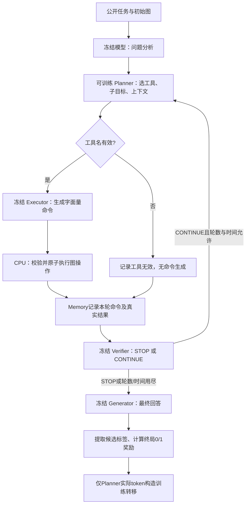

> 发布说明：本文保留原服务器的历史设计、实例和参数演变。2026-11-17 的 GitHub 发布启动配置为 Qwen2.5-7B、8×H200、每次生成上限 8192；当前执行参数请以 [README.md](README.md) 和 configs 为准。

# 6_1-Flow 实现详解：真实实例、完整 Prompt、输出与检查规则

## 2026-11-16：完整审计Memory与精简模型输入分离

增加`code/prompt_memory.py`：原Memory仍逐轮保存完整tool_name、sub_goal、command、result及各轮current_graph；GraphSession.audit与train_rollouts.jsonl继续保存完整证据。Planner、Verifier与最终Generator通过PromptMemory读取一份最新current_graph和逐轮操作摘要（工具、子目标、原始命令、ok/changed/graph_unchanged/errors），不再读取历史图快照。原Query中的初始图保留，Executor继续直接注入GraphSession最新真实图。问题分析只执行一次，不涉及历史图。

该视图是确定性字典过滤，不调用LLM摘要、不修改实际图、奖励或Flow-GRPO公式。所有历史错误仍可供纠错。摘要目前保留完整命令及子目标，因此不承诺固定token上限；模型自行在context中复述图也仍可能增加文本量。采样前即构造新prompt，训练继续使用服务端真实prompt/response token IDs，禁止采样后为训练另改输入。

对之前OOM批次最长样本做离线固定输出回放：原Planner最长输入13541 token，新视图最长5505 token，减少59.35%；固定角色最长输入从15198降为5569。回放最终图与原记录一致，保留10轮完整审计；这仅证明prompt构造与历史保留，不是新策略预测效果或真实GPU反向传播通过的证明。证据见`verification/prompt_memory_comparison.json`、`prompt_memory_replay.json`。

训练从原始3轮运行的第30步完整检查点重启，恢复模型、优化器、scheduler、RNG与dataloader，然后按10轮、禁止空动作、新视图重新采样。之前10轮失败运行第31步未保存，故需重跑。BF16、LoRA、每源6采样、每2源一次更新保留。


## 2026-11-16：工具轮数上限提高到10

按用户要求，tool_steps及run_workflow默认max_steps从3改为10，训练和merge后测试均使用10轮。每轮至多一次Planner、一次Executor、一次Verifier，另加初始问题分析与最终Generator，正常路径最多32次LLM生成。Verifier可提前STOP；500秒循环软限制和2048单次输出上限保持原配置。四工具继续要求非空actions，BF16、LoRA、每源6采样、每次更新2源保持原设置。

旧运行已完成到第36次更新，但最新完整可恢复检查点为global_step_30；新运行从该检查点恢复模型、优化器、scheduler、RNG与dataloader，第31步之后未保存的更新重跑。新运行独立目录保留来源记录，最终目标仍为累计500次更新，之后merge并测试两组各600条。旧运行及本文中3轮实例作为历史证据保留，不代表当前轮数配置。


本文主体记录禁止空动作之前的实现及正式训练日志；2026-11-16用户要求禁止空动作后的变更见本节下方。模型调用的 prompt/output 均直接复制真实轨迹，不重新调用模型，不把手写示例当作实测输出。本文中的“检查”明确区分代码强制约束、模型自行判断和提示文字要求。


## 规则更新：四工具禁止空动作（2026-11-16）

当前版本中，Planner既然自主选择工具，每次调用必须包含1—64条action。`actions=[]`统一返回`ok=false`、`EMPTY_ACTIONS`、`graph_unchanged=true`，附带真实current_graph；不执行修改，不新增重采样或独立罚分。公共规则、工具metadata与命令示例已同步改为非空。已有存在边、保护节点、真实文本变化等检查继续生效。Verifier仍可结束后续循环，未增加STOP工具或修改3轮上限。

下文11次真实调用保留历史原文，其中prompt若出现允许空动作，属于规则变更前的实测记录，不能当作新运行的prompt。新运行沿用相同prompt构造路径，但嵌入新的非空公共规则与metadata。

## 1. 框架与模块分工

6_1-Flow 用 AgentFlow 的原 Solver 串联问题分析、Planner、Executor、Memory、Verifier 和最终 Generator；RL 训练底层为 VERL 0.5.0，采用 Ray、PyTorch FSDP、vLLM、Transformers 和 PEFT。没有使用 TRL GRPOTrainer。

只有 Planner.generate_next_step 的 LoRA 可训练。问题分析、Executor 命令生成、Verifier 与最终 Generator 共用冻结原始 Qwen2.5-7B-Instruct；“Generator”是 Planner.generate_direct_output 方法调用固定 engine，并非另建一套可训练模型。原始模型来自 `Graph-R1-main/locals/Qwen/Qwen2.5-7B-Instruct`，LoRA rank=32、alpha=32，target_modules 为 q/k/v/o/gate/up/down projection。

| 资源 | 承担工作 |
| --- | --- |
| GPU 0、1 | FSDP 共同训练一个 Planner 策略；每卡有当前策略的异步 vLLM 采样引擎，推理和训练分阶段切换 |
| GPU 2 | 冻结原始7B服务，供问题分析、Executor、Verifier、Generator共用 |
| CPU | 数据准备、图校验与执行、Memory、奖励计算、卸载与最终merge |

基础权重、LoRA、梯度、归约和Adam动量使用BF16；整数token、计数器与框架统计标量保留原生类型。异步采样时把当前LoRA与不可变基础权重组合为推理权重，训练PEFT模型保持未merge。最终训练完成后单独merge，再测试。

## 2. 一条任务的流程及最多生成次数



| 调用/操作 | 单条完整flow上限 | 是否LLM生成 | 是否进入策略loss |
| --- | ---: | --- | --- |
| 问题分析 | 1 | 是，冻结模型 | 否 |
| Planner决策 | 3 | 是，可训练策略 | 是 |
| Executor生成命令 | 3 | 是，冻结模型；工具无效时跳过 | 否 |
| 图操作执行 | 3次工具调用，每次最多64个actions | 否，CPU确定性代码 | 否 |
| Verifier | 3 | 是，冻结模型 | 否 |
| 最终Generator | 1 | 是，冻结模型 | 否 |
| 合计 | **最多11次LLM生成：1 + 3×3 + 1** | — | 最多3个Planner转移 |

若执行k轮、其中e轮工具有效，则生成次数是 `2 + 2k + e`；正常1/2/3轮且工具均有效时为5/8/11次。无效工具仍消耗一轮Planner和Verifier调用，不会在该轮重新生成Planner。图操作失败也不会额外重试；下一轮可以再次选择同一工具。四工具可自由排序、重复使用，旧版本允许`actions=[]`（现已禁止，见规则更新）；没有强制依次跑四个操作的FSM。3轮意味着一条flow可能只使用部分工具。

一次更新采样2条源数据×每条6个flow，共12条独立流程，上限132次LLM生成、36个Planner训练转移。6指完整流程采样数，并非单次聊天请求返回6个答案；本地线程池并发数为2。每个flow有独立GraphSession与Memory。

每次生成最多2048个输出token，完整flow的名义输出预算上限为11×2048=22528 token；一批为270336 token。实际任一调用以length结束就终止该flow为容量失败，不会继续把所有上限用满。Planner训练输入上限18432，异步Planner上下文20480；固定服务上下文32768。输入长度上限与输出token数是不同概念。

`agent_timeout=500`是在问题分析开始后计时、仅在每轮循环开始检查的软限制，不会中途打断一次调用，也不阻止循环退出后最终Generator。HTTP单次请求timeout为600秒，因此500秒不构成整条流程的硬截止。

## 3. 公开输入与状态传递

public_episode白名单只取task_type、target、target_node、label_space、noisy_graph、protected_nodes、protected_edges、protected_query_nodes，并把目标/查询端点加入保护节点。clean_graph、ground_truth、噪声位置或数量不进入模型prompt。监督信息只在流程结束后用于评分与离线日志。

build_question拼接公共规则、PUBLIC TASK JSON与序列化初始图。问题分析看到它和四工具metadata；后续Planner还看到query_analysis和Memory。Executor在Planner给出的context之外，额外得到`CURRENT GRAPH (authoritative)`，始终由当前GraphSession产生。图执行结果包含current_graph，即使失败也返回未改变的图。Verifier和Generator通过Memory接收这些结果。

Memory不是LLM摘要，不做额外生成；每轮保存tool_name、sub_goal、command、result。原Solver对结果递归做可序列化处理，单个字符串最多100000字符，之后放进Memory；这与token截断不同。本例完整真实prompt全部列于后文，未由本文缩写。

## 4. 各模块的输出检查与失败处理

### 4.1 所有模型调用共有的处理

Engine构造system/user两条message，system固定为`You are a helpful, creative, and smart assistant.`。有schema时把其Pydantic JSON Schema附加在user末尾。固定角色额外请求`response_format={"type":"json_object"}`，只约束JSON对象，不强制全部字段符合schema；Planner没有服务端JSON约束解码。

收到HTTP 200后，记录原始raw_output、finish_reason和usage。训练Planner还必须提供服务端实际prompt_token_ids及response_token_ids，不能靠重新编码替代；检查Planner prompt≤18432。输出finish_reason=length时抛CapacityError。特定上下文/长度HTTP400也归为容量错误，其他HTTP错误或基础设施异常使当前批次中止，不伪造0分继续训练。

有schema的输出先移除单个JSON Markdown围栏，再Pydantic校验；失败返回原始文本，交给上游解析器继续处理。**schema解析失败并不等于整条流程直接失败，也没有自动重采样**。原始输出与原始token始终保留。

### 4.2 问题分析 QueryAnalysis

字段：concise_summary、required_skills、relevant_tools、additional_considerations，均为字符串。成功后转成QueryAnalysis的文本表示传给后续模块；失败时原始文本仍被用作分析结果。没有额外判断分析是否正确、工具建议是否合理、是否真的不含标签暗示；Pydantic字符串字段也未额外要求非空或禁止多余字段。

### 4.3 Planner NextStep

字段：justification、context、sub_goal、tool_name，均为字符串。上游优先读NextStep对象，否则尝试JSON和`Context/Sub-Goal/Tool Name`文本正则；工具名忽略大小写，并对空格/下划线归一化，然后与四个工具名匹配。解析失败返回None；工具不在允许列表时跳过Executor，记录无命令/无结果，仍写Memory并调用Verifier。

没有代码验证justification/context/sub_goal的事实正确性、非空性、是否真的是“最优下一步”。语义要求主要来自prompt。无效决策的实际token仍属于Planner轨迹，最终按该flow终局奖励训练。

### 4.4 Executor ToolCommand 与命令语法

外层字段analysis、explanation、command均为字符串。上游优先Pydantic/JSON，失败尝试文本正则和python代码块，清理围栏后交给GraphRL字面量执行器。外层analysis/explanation不直接进入图参数校验；真正执行的analysis/actions必须来自command里的tool.execute关键字。

AST检查要求只有一条语句、唯一赋值目标execution、调用恰为tool.execute、只允许analysis和actions两个关键字且各出现一次，不允许位置参数、**展开、导入、变量引用、函数调用或额外Python语句。ast.literal_eval之后再递归限定JSON兼容类型：有限数值、字符串、bool、None、列表、字符串键字典；集合、元组、bytes、复数和非有限浮点都拒绝。集合拒绝规则修复了此前非法命令污染审计数据并导致json.dumps退出的问题。

命令错误返回ok=false、COMMAND_SCHEMA、graph_unchanged=true和真实current_graph，原始命令以文本保留；不会执行任意Python。

### 4.5 图操作参数与环境约束

| 工具 | 必须的op | action精确字段 |
| --- | --- | --- |
| del_node | DELETE_NODE | op、node |
| del_edge | DEL_EDGE | op、u、v |
| add_edge | ADD_EDGE | op、u、v |
| rewrite | REWRITE | op、node、text |

公共检查：工具名合法；arguments字段为analysis/actions；analysis必须非空字符串；actions必须列表、最多64条；action必须字典、字段精确匹配；node/u/v必须是真正整数，拒绝bool、字符串、浮点；REWRITE text必须非空字符串。GraphSession传expected_tool=None，所以不存在固定阶段顺序限制。

环境检查：删除节点必须存在且非保护节点；边端点必须存在、无自环、非保护边；ADD_EDGE要求原图中不存在、DEL_EDGE要求存在；同批禁止重复/冲突边动作及边动作与节点删除冲突；禁止重复删节点、重复改同节点。REWRITE仅允许目标/查询端点、不得与删节点冲突，忽略空白大小写后必须确实改变原文本。任何错误使整个actions批次原子拒绝，不能只执行前几条；成功后确定性执行器更新图，校验与执行不一致则抛异常。

**语义边界：**“改写必须保留事实、不得编造类别提示”“删边必须有充分依据”存在于prompt，但代码未使用语义模型或隐藏clean_graph强制验证这些条件。结构上合法的错误删边或带标签暗示的rewrite仍可能ok=true。ok=true只说明操作通过现有结构/权限检查，不证明恢复正确。旧版本允许actions=[]无操作；当前版本已改为返回EMPTY_ACTIONS并保持图不变。

### 4.6 Verifier MemoryVerification

字段analysis:str、stop_signal:bool，Pydantic使用默认解析规则（非strict模式）。有效对象中true→STOP，false→CONTINUE。若schema/JSON失败，上游先找最后一个Conclusion: STOP/CONTINUE，再在全文搜索stop或continue；均找不到则CONTINUE。全文关键词回退较宽松，含stop的解释文本可能触发STOP。

Verifier是冻结模型根据公开上下文的判断，不能访问隐藏ground_truth/clean_graph，也不是最终奖励判定器。即使它STOP，也不证明图恢复或分类正确。STOP仅结束工具循环，之后仍调用Generator。

### 4.7 最终Generator与标签评分

最终Generator不传Pydantic response_format。上游prompt要求Process Summary与Answer，公共任务规则要求analysis/prediction JSON；所以允许模型输出过程说明包围最终JSON。extract_prediction先尝试整段JSON，再扫描每个左花括号解码JSON对象，收集字符串prediction。所有候选prediction规范化后必须唯一，且必须属于公开label_space，否则prediction=None。

标签规范化会合并空白、去除两端空白/引号/句点/逗号并casefold；不是严格逐字节匹配。相同标签重复出现不导致失败，不同标签导致歧义失败。不会把任意纯文本标签直接提取为答案；也不强制检查最终analysis字段存在/非空、字段顺序或有无额外字段。graph_core.validation.inspect_final虽然存在，**当前workflow未调用它**。

reward=1当且仅当提取到的标签与ground_truth规范化后一致，否则0。没有额外格式奖励、图恢复奖励或每次非法动作罚分；动作问题可通过最终预测间接影响奖励。graph_exact/dirty_graph_exact用于记录与评估，不参与训练奖励。终答正确与图恢复正确分别记录。

### 4.8 容量与基础设施失败

CapacityError由workflow捕获：prediction=None、reward=0，并记录capacity_failure。已有Planner轨迹仍可带0分进入训练；若容量失败发生在首个Planner前，没有Planner trace，训练transport明确报错中止。trace超过训练配置上限时拒绝静默截断。基础设施失败中止批次，不按reward挑选流程或重采。

## 5. 训练、merge和测试如何衔接

每个源问题6条flow共享源分组ID；所有Planner转移得到所在flow的同一终局奖励。AgentFlow原daemon把真实token转为训练张量，VERL按源组做Flow-GRPO优势；可变长度flow的转移数量影响组内权重，没有先把每flow平均成一个样本。旧策略与reference logprob均通过训练模块计算，reference可禁用LoRA复用actor基础模型。

先用真实转移计算优势，之后为双卡对齐补零loss padding，保留全部转移；每卡microbatch=1，累计本批所有转移，只做一次同步actor优化器更新。lr=1e-6，KL loss系数0.001，clip low/high=0.2/0.3，entropy系数0，ppo_epochs=1。参数、梯度、Adam动量dtype都有运行断言。终局奖励全相同的组优势为0，仍可能执行一次optimizer.step，但不能据此断言参数有实质变化。

正式训练1000源、1 epoch、500次更新；第1步、之后每10步和最后一步保存，保留最近两份。最后选actor/lora_adapter，与原始模型在CPU合并并输出BF16模型。测试时合并模型只充当Planner，辅助角色仍用冻结原始7B；两组测试各600条、每条1个flow，Planner temperature=0。训练temperature=0.7，固定角色temperature=0，Engine请求top_p=.99、frequency_penalty=1.2；服务端可能对temperature=0等参数做内部归一化。

## 6. 真实实例来源与完整调用顺序

轨迹来源：`runs/6_1_Flow_bf16_jsonfix_20261116_100306/train_rollouts.jsonl`。本例为训练时采样轨迹，不是merge后测试，也不是额外手工生成。source_index不是训练顺序；step是采样批号，candidate从0开始。示例选择用于覆盖三个完整轮次、失败反馈与后续成功操作，不代表总体准确率。

````json
{
  "source_index": 273,
  "task_type": "NC",
  "dataset": "instagram",
  "step": 5,
  "candidate": 5,
  "rollout_id": "bd171bbf-257d-457d-a785-61724a25c11c",
  "data_id": "d330ba13-5b43-4814-a9de-efdff2a887f4",
  "prediction": "Normal Users",
  "ground_truth": "Normal Users",
  "reward": 1.0,
  "input_dirty": true,
  "graph_exact": false,
  "capacity_failure": null,
  "seconds": 36.9563914835453
}
````

冻结证据：[implementation_example.json](verification/implementation_example.json)，SHA256：`a47420034115bbf457589666603ab289379c33abff61fcf1953031daae14f785`。该JSON还保留真实Planner token IDs；本文逐次列出完整API消息内容与原始输出，不把token ID长数组重复打印。

### 6.1 本例公开任务

````text
Solve the public graph classification task. The initial graph may contain noise. Use only graph structure, node text and public constraints; noise locations and amounts are unknown. Use the CURRENT graph in the latest successful tool result; failed calls do not change it. Select any of del_node, del_edge, add_edge, rewrite in any order; repeats and empty actions are allowed. Never delete protected nodes or edit protected edges. No self-loops, missing endpoints, duplicate/conflicting actions. DEL_EDGE requires a present edge, ADD_EDGE an absent edge. REWRITE only target/query endpoints; preserve supported facts and never invent labels or answer hints. Submit the final answer as one JSON object {"analysis":"prediction reasoning","prediction":"one exact candidate label"}. Do not use a ground-truth label or hidden clean graph. A tool command must be exactly execution = tool.execute(analysis="reason", actions=[...]), using literal parameter values. The generator decides the final label from the current graph.
PUBLIC TASK
{"task_type": "NC", "target": "node1", "target_node": 1, "label_space": ["Commercial Users", "Normal Users"], "protected_nodes": [1], "protected_edges": [], "protected_query_nodes": [1]}
<initial_graph>
node0: Music store in San Pedro, CA, selling vinyl, open Tues-Sat, accepts PayPal, offers shipping.
node1: 90s nostalgia, vinyl music discussions, pop culture, Britney Spears, Black History Month focus, and Germany’s pop culture through software culture, with an angelic touch. #vinylgram
node2: Germany Hessen
node3: Software developer 👩🏽‍💻 Stockholm
node4: earth angel

Connections:
<node1, node2>
<node1, node3>
<node1, node4>
</initial_graph>
````

### 6.2 十一次真实模型调用

以下按Solver实际执行次序排列，每次列出system/user完整内容（包括附加schema）、原始输出、finish_reason和token用量。消息内容保留日志原文，未用占位符省略重复的图或Memory。HTTP请求本身是system/user消息；Qwen聊天模板由服务端tokenizer应用，API日志没有单独记录模板展开后的字符串。

| 顺序 | 模块 | 输入token | 输出token | finish_reason |
| --- | --- | ---: | ---: | --- |
| 1 | 问题分析 | 971 | 139 | stop |
| 2 | 第1轮 Planner | 1229 | 172 | stop |
| 3 | 第1轮 Executor | 1020 | 191 | stop |
| 4 | 第1轮 Verifier | 1451 | 107 | stop |
| 5 | 第2轮 Planner | 1533 | 245 | stop |
| 6 | 第2轮 Executor | 1080 | 180 | stop |
| 7 | 第2轮 Verifier | 1755 | 137 | stop |
| 8 | 第3轮 Planner | 1837 | 207 | stop |
| 9 | 第3轮 Executor | 1043 | 164 | stop |
| 10 | 第3轮 Verifier | 1996 | 134 | stop |
| 11 | 最终 Generator | 1520 | 287 | stop |

#### 调用 1：问题分析


**完整 system prompt：**

````text
You are a helpful, creative, and smart assistant.
````

**完整 user prompt：**

````text

Task: Analyze the given query to determine necessary skills and tools.

Inputs:
- Query: Solve the public graph classification task. The initial graph may contain noise. Use only graph structure, node text and public constraints; noise locations and amounts are unknown. Use the CURRENT graph in the latest successful tool result; failed calls do not change it. Select any of del_node, del_edge, add_edge, rewrite in any order; repeats and empty actions are allowed. Never delete protected nodes or edit protected edges. No self-loops, missing endpoints, duplicate/conflicting actions. DEL_EDGE requires a present edge, ADD_EDGE an absent edge. REWRITE only target/query endpoints; preserve supported facts and never invent labels or answer hints. Submit the final answer as one JSON object {"analysis":"prediction reasoning","prediction":"one exact candidate label"}. Do not use a ground-truth label or hidden clean graph. A tool command must be exactly execution = tool.execute(analysis="reason", actions=[...]), using literal parameter values. The generator decides the final label from the current graph.
PUBLIC TASK
{"task_type": "NC", "target": "node1", "target_node": 1, "label_space": ["Commercial Users", "Normal Users"], "protected_nodes": [1], "protected_edges": [], "protected_query_nodes": [1]}
<initial_graph>
node0: Music store in San Pedro, CA, selling vinyl, open Tues-Sat, accepts PayPal, offers shipping.
node1: 90s nostalgia, vinyl music discussions, pop culture, Britney Spears, Black History Month focus, and Germany’s pop culture through software culture, with an angelic touch. #vinylgram
node2: Germany Hessen
node3: Software developer 👩🏽‍💻 Stockholm
node4: earth angel

Connections:
<node1, node2>
<node1, node3>
<node1, node4>
</initial_graph>
- Available tools: ['del_node', 'del_edge', 'add_edge', 'rewrite']
- Metadata for tools: {'del_node': {'tool_name': 'del_node', 'description': 'Delete unsupported noise nodes.', 'parameters': {'analysis': 'nonempty evidence-based reasoning', 'actions': "List of actions with op=DELETE_NODE and exactly fields ['node', 'op']; [] means no edit"}, 'command_example': 'execution = tool.execute(analysis="reason", actions=[])'}, 'del_edge': {'tool_name': 'del_edge', 'description': 'Delete unsupported edges.', 'parameters': {'analysis': 'nonempty evidence-based reasoning', 'actions': "List of actions with op=DEL_EDGE and exactly fields ['op', 'u', 'v']; [] means no edit"}, 'command_example': 'execution = tool.execute(analysis="reason", actions=[])'}, 'add_edge': {'tool_name': 'add_edge', 'description': 'Restore missing supported edges.', 'parameters': {'analysis': 'nonempty evidence-based reasoning', 'actions': "List of actions with op=ADD_EDGE and exactly fields ['op', 'u', 'v']; [] means no edit"}, 'command_example': 'execution = tool.execute(analysis="reason", actions=[])'}, 'rewrite': {'tool_name': 'rewrite', 'description': 'Repair noise in target/query node text.', 'parameters': {'analysis': 'nonempty evidence-based reasoning', 'actions': "List of actions with op=REWRITE and exactly fields ['node', 'op', 'text']; [] means no edit"}, 'command_example': 'execution = tool.execute(analysis="reason", actions=[])'}}

Instructions:
1. Identify the main objectives in the query.
2. List the necessary skills and tools.
3. For each skill and tool, explain how it helps address the query.
4. Note any additional considerations.

Format your response with a summary of the query, lists of skills and tools with explanations, and a section for additional considerations.

Be biref and precise with insight. 

Return exactly one JSON object matching this schema: {"properties": {"concise_summary": {"title": "Concise Summary", "type": "string"}, "required_skills": {"title": "Required Skills", "type": "string"}, "relevant_tools": {"title": "Relevant Tools", "type": "string"}, "additional_considerations": {"title": "Additional Considerations", "type": "string"}}, "required": ["concise_summary", "required_skills", "relevant_tools", "additional_considerations"], "title": "QueryAnalysis", "type": "object"}
````

**模型原始输出：**

````text
{
  "concise_summary": "The task involves classifying a noisy graph into one of two categories ('Commercial Users' or 'Normal Users') based on the provided node texts and connections, while preserving certain nodes and edges.",
  "required_skills": "Graph analysis, noise reduction, text understanding, classification",
  "relevant_tools": "[del_node, del_edge, add_edge, rewrite]",
  "additional_considerations": [
    "Preserve protected nodes (node1) and edges.",
    "Ensure no self-loops or duplicate/conflicting actions are created.",
    "Use only graph structure and node text for classification; avoid using ground-truth labels."
  ]
}
````

**调用记录：**

````json
{
  "role": "fixed",
  "finish_reason": "stop",
  "usage": {
    "prompt_tokens": 971,
    "total_tokens": 1110,
    "completion_tokens": 139,
    "prompt_tokens_details": null
  }
}
````

#### 调用 2：第1轮 Planner


**完整 system prompt：**

````text
You are a helpful, creative, and smart assistant.
````

**完整 user prompt：**

````text

Task: Determine the optimal next step to address the query using available tools and previous steps.

Context:
- **Query:** Solve the public graph classification task. The initial graph may contain noise. Use only graph structure, node text and public constraints; noise locations and amounts are unknown. Use the CURRENT graph in the latest successful tool result; failed calls do not change it. Select any of del_node, del_edge, add_edge, rewrite in any order; repeats and empty actions are allowed. Never delete protected nodes or edit protected edges. No self-loops, missing endpoints, duplicate/conflicting actions. DEL_EDGE requires a present edge, ADD_EDGE an absent edge. REWRITE only target/query endpoints; preserve supported facts and never invent labels or answer hints. Submit the final answer as one JSON object {"analysis":"prediction reasoning","prediction":"one exact candidate label"}. Do not use a ground-truth label or hidden clean graph. A tool command must be exactly execution = tool.execute(analysis="reason", actions=[...]), using literal parameter values. The generator decides the final label from the current graph.
PUBLIC TASK
{"task_type": "NC", "target": "node1", "target_node": 1, "label_space": ["Commercial Users", "Normal Users"], "protected_nodes": [1], "protected_edges": [], "protected_query_nodes": [1]}
<initial_graph>
node0: Music store in San Pedro, CA, selling vinyl, open Tues-Sat, accepts PayPal, offers shipping.
node1: 90s nostalgia, vinyl music discussions, pop culture, Britney Spears, Black History Month focus, and Germany’s pop culture through software culture, with an angelic touch. #vinylgram
node2: Germany Hessen
node3: Software developer 👩🏽‍💻 Stockholm
node4: earth angel

Connections:
<node1, node2>
<node1, node3>
<node1, node4>
</initial_graph>
- **Query Analysis:** {
  "concise_summary": "The task involves classifying a noisy graph into one of two categories ('Commercial Users' or 'Normal Users') based on the provided node texts and connections, while preserving certain nodes and edges.",
  "required_skills": "Graph analysis, noise reduction, text understanding, classification",
  "relevant_tools": "[del_node, del_edge, add_edge, rewrite]",
  "additional_considerations": [
    "Preserve protected nodes (node1) and edges.",
    "Ensure no self-loops or duplicate/conflicting actions are created.",
    "Use only graph structure and node text for classification; avoid using ground-truth labels."
  ]
}
- **Available Tools:** ['del_node', 'del_edge', 'add_edge', 'rewrite']
- **Toolbox Metadata:** {'del_node': {'tool_name': 'del_node', 'description': 'Delete unsupported noise nodes.', 'parameters': {'analysis': 'nonempty evidence-based reasoning', 'actions': "List of actions with op=DELETE_NODE and exactly fields ['node', 'op']; [] means no edit"}, 'command_example': 'execution = tool.execute(analysis="reason", actions=[])'}, 'del_edge': {'tool_name': 'del_edge', 'description': 'Delete unsupported edges.', 'parameters': {'analysis': 'nonempty evidence-based reasoning', 'actions': "List of actions with op=DEL_EDGE and exactly fields ['op', 'u', 'v']; [] means no edit"}, 'command_example': 'execution = tool.execute(analysis="reason", actions=[])'}, 'add_edge': {'tool_name': 'add_edge', 'description': 'Restore missing supported edges.', 'parameters': {'analysis': 'nonempty evidence-based reasoning', 'actions': "List of actions with op=ADD_EDGE and exactly fields ['op', 'u', 'v']; [] means no edit"}, 'command_example': 'execution = tool.execute(analysis="reason", actions=[])'}, 'rewrite': {'tool_name': 'rewrite', 'description': 'Repair noise in target/query node text.', 'parameters': {'analysis': 'nonempty evidence-based reasoning', 'actions': "List of actions with op=REWRITE and exactly fields ['node', 'op', 'text']; [] means no edit"}, 'command_example': 'execution = tool.execute(analysis="reason", actions=[])'}}
- **Previous Steps:** {}

Instructions:
1. Analyze the query, previous steps, and available tools.
2. Select the **single best tool** for the next step.
3. Formulate a specific, achievable **sub-goal** for that tool.
4. Provide all necessary **context** (data, file names, variables) for the tool to function.

Response Format:
1.  **Justification:** Explain your choice of tool and sub-goal.
2.  **Context:** Provide all necessary information for the tool.
3.  **Sub-Goal:** State the specific objective for the tool.
4.  **Tool Name:** State the exact name of the selected tool.

Rules:
- Select only ONE tool.
- The sub-goal must be directly achievable by the selected tool.
- The Context section must contain all information the tool needs to function.
- The response must end with the Context, Sub-Goal, and Tool Name sections in that order, with no extra content.
                    
Return exactly one JSON object matching this schema: {"properties": {"justification": {"title": "Justification", "type": "string"}, "context": {"title": "Context", "type": "string"}, "sub_goal": {"title": "Sub Goal", "type": "string"}, "tool_name": {"title": "Tool Name", "type": "string"}}, "required": ["justification", "context", "sub_goal", "tool_name"], "title": "NextStep", "type": "object"}
````

**模型原始输出：**

````text
{
  "justification": "The initial graph contains text that is more aligned with 'Normal Users' than 'Commercial Users'. The node texts and connections suggest a focus on personal interests and cultural discussions rather than commercial activities. Therefore, the del_edge tool is chosen to remove connections that are less relevant to 'Normal Users', potentially clarifying the classification.",
  "context": "{\"task_type\": \"NC\", \"target\": \"node1\", \"target_node\": 1, \"label_space\": [\"Commercial Users\", \"Normal Users\"], \"protected_nodes\": [1], \"protected_edges\": [], \"protected_query_nodes\": [1]}, <initial_graph>",
  "sub_goal": "Remove edges that connect node1 to nodes which do not contribute to the classification as 'Normal Users'.",
  "tool_name": "del_edge"
}
````

**调用记录：**

````json
{
  "role": "planner",
  "finish_reason": "stop",
  "usage": {
    "prompt_tokens": 1229,
    "total_tokens": 1401,
    "completion_tokens": 172,
    "prompt_tokens_details": null
  }
}
````

#### 调用 3：第1轮 Executor


**完整 system prompt：**

````text
You are a helpful, creative, and smart assistant.
````

**完整 user prompt：**

````text

        Task: Generate a precise command to execute the selected tool.

Context:
- **Query:** Solve the public graph classification task. The initial graph may contain noise. Use only graph structure, node text and public constraints; noise locations and amounts are unknown. Use the CURRENT graph in the latest successful tool result; failed calls do not change it. Select any of del_node, del_edge, add_edge, rewrite in any order; repeats and empty actions are allowed. Never delete protected nodes or edit protected edges. No self-loops, missing endpoints, duplicate/conflicting actions. DEL_EDGE requires a present edge, ADD_EDGE an absent edge. REWRITE only target/query endpoints; preserve supported facts and never invent labels or answer hints. Submit the final answer as one JSON object {"analysis":"prediction reasoning","prediction":"one exact candidate label"}. Do not use a ground-truth label or hidden clean graph. A tool command must be exactly execution = tool.execute(analysis="reason", actions=[...]), using literal parameter values. The generator decides the final label from the current graph.
PUBLIC TASK
{"task_type": "NC", "target": "node1", "target_node": 1, "label_space": ["Commercial Users", "Normal Users"], "protected_nodes": [1], "protected_edges": [], "protected_query_nodes": [1]}
<initial_graph>
node0: Music store in San Pedro, CA, selling vinyl, open Tues-Sat, accepts PayPal, offers shipping.
node1: 90s nostalgia, vinyl music discussions, pop culture, Britney Spears, Black History Month focus, and Germany’s pop culture through software culture, with an angelic touch. #vinylgram
node2: Germany Hessen
node3: Software developer 👩🏽‍💻 Stockholm
node4: earth angel

Connections:
<node1, node2>
<node1, node3>
<node1, node4>
</initial_graph>
- **Sub-Goal:** Remove edges that connect node1 to nodes which do not contribute to the classification as 'Normal Users'.
- **Tool Name:** del_edge
- **Tool Metadata:** {'tool_name': 'del_edge', 'description': 'Delete unsupported edges.', 'parameters': {'analysis': 'nonempty evidence-based reasoning', 'actions': "List of actions with op=DEL_EDGE and exactly fields ['op', 'u', 'v']; [] means no edit"}, 'command_example': 'execution = tool.execute(analysis="reason", actions=[])'}
- **Relevant Data:** {"task_type": "NC", "target": "node1", "target_node": 1, "label_space": ["Commercial Users", "Normal Users"], "protected_nodes": [1], "protected_edges": [], "protected_query_nodes": [1]}, <initial_graph>
CURRENT GRAPH (authoritative)
node0: Music store in San Pedro, CA, selling vinyl, open Tues-Sat, accepts PayPal, offers shipping.
node1: 90s nostalgia, vinyl music discussions, pop culture, Britney Spears, Black History Month focus, and Germany’s pop culture through software culture, with an angelic touch. #vinylgram
node2: Germany Hessen
node3: Software developer 👩🏽‍💻 Stockholm
node4: earth angel

Connections:
<node1, node2>
<node1, node3>
<node1, node4>

Instructions:
1.  Analyze the tool's required parameters from its metadata.
2.  Construct valid Python code that addresses the sub-goal using the provided context and data.
3.  The command must include at least one call to `tool.execute()`.
4.  Each `tool.execute()` call must be assigned to a variable named **`execution`**.
5.  Please give the exact numbers and parameters should be used in the `tool.execute()` call.

Output Format:
Present your response in the following structured format. Do not include any extra text or explanations.

Generated Command:
```python
<command>
```

Example1:
Generated Command:
```python
execution = tool.execute(query="Summarize the following porblom:"Isaac has 100 toys, masa gets ...., how much are their together?")
```

Example2:
Generated Command:
```python
execution = tool.execute(query=["Methanol", "function of hyperbola", "Fermat's Last Theorem"])
```

Return exactly one JSON object matching this schema: {"properties": {"analysis": {"title": "Analysis", "type": "string"}, "explanation": {"title": "Explanation", "type": "string"}, "command": {"title": "Command", "type": "string"}}, "required": ["analysis", "explanation", "command"], "title": "ToolCommand", "type": "object"}
````

**模型原始输出：**

````text
{
    "analysis": "Remove edges connecting node1 to nodes that do not contribute to the classification as 'Normal Users'.",
    "explanation": "The current graph contains edges between node1 and nodes2, node3, and node4. Since the task is to classify node1 as either 'Commercial Users' or 'Normal Users', we need to remove edges that do not support the classification of 'Normal Users'. Node2, node3, and node4 are not directly related to the characteristics of normal users based on their descriptions.",
    "command": "execution = tool.execute(analysis='nonempty evidence-based reasoning', actions=[{'op': 'DEL_EDGE', 'u': 1, 'v': 2}, {'op': 'DEL_EDGE', 'u': 1, 'v': 3}, {'op': 'DEL_EDGE', 'u': 1, ‘v’: 4}])"
}
````

**调用记录：**

````json
{
  "role": "fixed",
  "finish_reason": "stop",
  "usage": {
    "prompt_tokens": 1020,
    "total_tokens": 1211,
    "completion_tokens": 191,
    "prompt_tokens_details": null
  }
}
````

**CPU校验/执行结果（非LLM生成）：**

````json
{
  "tool": "del_edge",
  "analysis": null,
  "actions": null,
  "raw_command": "execution = tool.execute(analysis='nonempty evidence-based reasoning', actions=[{'op': 'DEL_EDGE', 'u': 1, 'v': 2}, {'op': 'DEL_EDGE', 'u': 1, 'v': 3}, {'op': 'DEL_EDGE', 'u': 1, ‘v’: 4}])",
  "result": {
    "ok": false,
    "errors": [
      {
        "code": "COMMAND_SCHEMA",
        "message": "invalid character '‘' (U+2018) (<unknown>, line 1)"
      }
    ],
    "graph_unchanged": true,
    "current_graph": "node0: Music store in San Pedro, CA, selling vinyl, open Tues-Sat, accepts PayPal, offers shipping.\nnode1: 90s nostalgia, vinyl music discussions, pop culture, Britney Spears, Black History Month focus, and Germany’s pop culture through software culture, with an angelic touch. #vinylgram\nnode2: Germany Hessen\nnode3: Software developer 👩🏽‍💻 Stockholm\nnode4: earth angel\n\nConnections:\n<node1, node2>\n<node1, node3>\n<node1, node4>"
  }
}
````

#### 调用 4：第1轮 Verifier


**完整 system prompt：**

````text
You are a helpful, creative, and smart assistant.
````

**完整 user prompt：**

````text

Task: Evaluate if the current memory is complete and accurate enough to answer the query, or if more tools are needed.

Context:
- **Query:** Solve the public graph classification task. The initial graph may contain noise. Use only graph structure, node text and public constraints; noise locations and amounts are unknown. Use the CURRENT graph in the latest successful tool result; failed calls do not change it. Select any of del_node, del_edge, add_edge, rewrite in any order; repeats and empty actions are allowed. Never delete protected nodes or edit protected edges. No self-loops, missing endpoints, duplicate/conflicting actions. DEL_EDGE requires a present edge, ADD_EDGE an absent edge. REWRITE only target/query endpoints; preserve supported facts and never invent labels or answer hints. Submit the final answer as one JSON object {"analysis":"prediction reasoning","prediction":"one exact candidate label"}. Do not use a ground-truth label or hidden clean graph. A tool command must be exactly execution = tool.execute(analysis="reason", actions=[...]), using literal parameter values. The generator decides the final label from the current graph.
PUBLIC TASK
{"task_type": "NC", "target": "node1", "target_node": 1, "label_space": ["Commercial Users", "Normal Users"], "protected_nodes": [1], "protected_edges": [], "protected_query_nodes": [1]}
<initial_graph>
node0: Music store in San Pedro, CA, selling vinyl, open Tues-Sat, accepts PayPal, offers shipping.
node1: 90s nostalgia, vinyl music discussions, pop culture, Britney Spears, Black History Month focus, and Germany’s pop culture through software culture, with an angelic touch. #vinylgram
node2: Germany Hessen
node3: Software developer 👩🏽‍💻 Stockholm
node4: earth angel

Connections:
<node1, node2>
<node1, node3>
<node1, node4>
</initial_graph>
- **Available Tools:** ['del_node', 'del_edge', 'add_edge', 'rewrite']
- **Toolbox Metadata:** {'del_node': {'tool_name': 'del_node', 'description': 'Delete unsupported noise nodes.', 'parameters': {'analysis': 'nonempty evidence-based reasoning', 'actions': "List of actions with op=DELETE_NODE and exactly fields ['node', 'op']; [] means no edit"}, 'command_example': 'execution = tool.execute(analysis="reason", actions=[])'}, 'del_edge': {'tool_name': 'del_edge', 'description': 'Delete unsupported edges.', 'parameters': {'analysis': 'nonempty evidence-based reasoning', 'actions': "List of actions with op=DEL_EDGE and exactly fields ['op', 'u', 'v']; [] means no edit"}, 'command_example': 'execution = tool.execute(analysis="reason", actions=[])'}, 'add_edge': {'tool_name': 'add_edge', 'description': 'Restore missing supported edges.', 'parameters': {'analysis': 'nonempty evidence-based reasoning', 'actions': "List of actions with op=ADD_EDGE and exactly fields ['op', 'u', 'v']; [] means no edit"}, 'command_example': 'execution = tool.execute(analysis="reason", actions=[])'}, 'rewrite': {'tool_name': 'rewrite', 'description': 'Repair noise in target/query node text.', 'parameters': {'analysis': 'nonempty evidence-based reasoning', 'actions': "List of actions with op=REWRITE and exactly fields ['node', 'op', 'text']; [] means no edit"}, 'command_example': 'execution = tool.execute(analysis="reason", actions=[])'}}
- **Initial Analysis:** {
  "concise_summary": "The task involves classifying a noisy graph into one of two categories ('Commercial Users' or 'Normal Users') based on the provided node texts and connections, while preserving certain nodes and edges.",
  "required_skills": "Graph analysis, noise reduction, text understanding, classification",
  "relevant_tools": "[del_node, del_edge, add_edge, rewrite]",
  "additional_considerations": [
    "Preserve protected nodes (node1) and edges.",
    "Ensure no self-loops or duplicate/conflicting actions are created.",
    "Use only graph structure and node text for classification; avoid using ground-truth labels."
  ]
}
- **Memory (Tools Used & Results):** {'Action Step 1': {'tool_name': 'del_edge', 'sub_goal': "Remove edges that connect node1 to nodes which do not contribute to the classification as 'Normal Users'.", 'command': "execution = tool.execute(analysis='nonempty evidence-based reasoning', actions=[{'op': 'DEL_EDGE', 'u': 1, 'v': 2}, {'op': 'DEL_EDGE', 'u': 1, 'v': 3}, {'op': 'DEL_EDGE', 'u': 1, ‘v’: 4}])", 'result': {'ok': False, 'errors': [{'code': 'COMMAND_SCHEMA', 'message': "invalid character '‘' (U+2018) (<unknown>, line 1)"}], 'graph_unchanged': True, 'current_graph': 'node0: Music store in San Pedro, CA, selling vinyl, open Tues-Sat, accepts PayPal, offers shipping.\nnode1: 90s nostalgia, vinyl music discussions, pop culture, Britney Spears, Black History Month focus, and Germany’s pop culture through software culture, with an angelic touch. #vinylgram\nnode2: Germany Hessen\nnode3: Software developer 👩🏽\u200d💻 Stockholm\nnode4: earth angel\n\nConnections:\n<node1, node2>\n<node1, node3>\n<node1, node4>'}}}

Instructions:
1.  Review the query, initial analysis, and memory.
2.  Assess the completeness of the memory: Does it fully address all parts of the query?
3.  Check for potential issues:
    -   Are there any inconsistencies or contradictions?
    -   Is any information ambiguous or in need of verification?
4.  Determine if any unused tools could provide missing information.

Final Determination:
-   If the memory is sufficient, explain why and conclude with "STOP".
-   If more information is needed, explain what's missing, which tools could help, and conclude with "CONTINUE".

IMPORTANT: The response must end with either "Conclusion: STOP" or "Conclusion: CONTINUE".

Return exactly one JSON object matching this schema: {"properties": {"analysis": {"title": "Analysis", "type": "string"}, "stop_signal": {"title": "Stop Signal", "type": "boolean"}}, "required": ["analysis", "stop_signal"], "title": "MemoryVerification", "type": "object"}
````

**模型原始输出：**

````text
{
  "analysis": "The current memory includes the necessary tools and steps to address the query, but there are some issues that need to be resolved before proceeding. Specifically, the edge removal step encountered an error due to an invalid character in the command. Additionally, we have not yet addressed potential noise within node texts or added any edges that might support our classification. The protected node (node1) is central to both classification and connectivity considerations, so ensuring its context is clear is crucial.",
  "stop_signal": false
}
````

**调用记录：**

````json
{
  "role": "fixed",
  "finish_reason": "stop",
  "usage": {
    "prompt_tokens": 1451,
    "total_tokens": 1558,
    "completion_tokens": 107,
    "prompt_tokens_details": null
  }
}
````

**本轮后Memory快照（非LLM生成）：**

````json
{
  "Action Step 1": {
    "tool_name": "del_edge",
    "sub_goal": "Remove edges that connect node1 to nodes which do not contribute to the classification as 'Normal Users'.",
    "command": "execution = tool.execute(analysis='nonempty evidence-based reasoning', actions=[{'op': 'DEL_EDGE', 'u': 1, 'v': 2}, {'op': 'DEL_EDGE', 'u': 1, 'v': 3}, {'op': 'DEL_EDGE', 'u': 1, ‘v’: 4}])",
    "result": {
      "ok": false,
      "errors": [
        {
          "code": "COMMAND_SCHEMA",
          "message": "invalid character '‘' (U+2018) (<unknown>, line 1)"
        }
      ],
      "graph_unchanged": true,
      "current_graph": "node0: Music store in San Pedro, CA, selling vinyl, open Tues-Sat, accepts PayPal, offers shipping.\nnode1: 90s nostalgia, vinyl music discussions, pop culture, Britney Spears, Black History Month focus, and Germany’s pop culture through software culture, with an angelic touch. #vinylgram\nnode2: Germany Hessen\nnode3: Software developer 👩🏽‍💻 Stockholm\nnode4: earth angel\n\nConnections:\n<node1, node2>\n<node1, node3>\n<node1, node4>"
    }
  }
}
````

#### 调用 5：第2轮 Planner


**完整 system prompt：**

````text
You are a helpful, creative, and smart assistant.
````

**完整 user prompt：**

````text

Task: Determine the optimal next step to address the query using available tools and previous steps.

Context:
- **Query:** Solve the public graph classification task. The initial graph may contain noise. Use only graph structure, node text and public constraints; noise locations and amounts are unknown. Use the CURRENT graph in the latest successful tool result; failed calls do not change it. Select any of del_node, del_edge, add_edge, rewrite in any order; repeats and empty actions are allowed. Never delete protected nodes or edit protected edges. No self-loops, missing endpoints, duplicate/conflicting actions. DEL_EDGE requires a present edge, ADD_EDGE an absent edge. REWRITE only target/query endpoints; preserve supported facts and never invent labels or answer hints. Submit the final answer as one JSON object {"analysis":"prediction reasoning","prediction":"one exact candidate label"}. Do not use a ground-truth label or hidden clean graph. A tool command must be exactly execution = tool.execute(analysis="reason", actions=[...]), using literal parameter values. The generator decides the final label from the current graph.
PUBLIC TASK
{"task_type": "NC", "target": "node1", "target_node": 1, "label_space": ["Commercial Users", "Normal Users"], "protected_nodes": [1], "protected_edges": [], "protected_query_nodes": [1]}
<initial_graph>
node0: Music store in San Pedro, CA, selling vinyl, open Tues-Sat, accepts PayPal, offers shipping.
node1: 90s nostalgia, vinyl music discussions, pop culture, Britney Spears, Black History Month focus, and Germany’s pop culture through software culture, with an angelic touch. #vinylgram
node2: Germany Hessen
node3: Software developer 👩🏽‍💻 Stockholm
node4: earth angel

Connections:
<node1, node2>
<node1, node3>
<node1, node4>
</initial_graph>
- **Query Analysis:** {
  "concise_summary": "The task involves classifying a noisy graph into one of two categories ('Commercial Users' or 'Normal Users') based on the provided node texts and connections, while preserving certain nodes and edges.",
  "required_skills": "Graph analysis, noise reduction, text understanding, classification",
  "relevant_tools": "[del_node, del_edge, add_edge, rewrite]",
  "additional_considerations": [
    "Preserve protected nodes (node1) and edges.",
    "Ensure no self-loops or duplicate/conflicting actions are created.",
    "Use only graph structure and node text for classification; avoid using ground-truth labels."
  ]
}
- **Available Tools:** ['del_node', 'del_edge', 'add_edge', 'rewrite']
- **Toolbox Metadata:** {'del_node': {'tool_name': 'del_node', 'description': 'Delete unsupported noise nodes.', 'parameters': {'analysis': 'nonempty evidence-based reasoning', 'actions': "List of actions with op=DELETE_NODE and exactly fields ['node', 'op']; [] means no edit"}, 'command_example': 'execution = tool.execute(analysis="reason", actions=[])'}, 'del_edge': {'tool_name': 'del_edge', 'description': 'Delete unsupported edges.', 'parameters': {'analysis': 'nonempty evidence-based reasoning', 'actions': "List of actions with op=DEL_EDGE and exactly fields ['op', 'u', 'v']; [] means no edit"}, 'command_example': 'execution = tool.execute(analysis="reason", actions=[])'}, 'add_edge': {'tool_name': 'add_edge', 'description': 'Restore missing supported edges.', 'parameters': {'analysis': 'nonempty evidence-based reasoning', 'actions': "List of actions with op=ADD_EDGE and exactly fields ['op', 'u', 'v']; [] means no edit"}, 'command_example': 'execution = tool.execute(analysis="reason", actions=[])'}, 'rewrite': {'tool_name': 'rewrite', 'description': 'Repair noise in target/query node text.', 'parameters': {'analysis': 'nonempty evidence-based reasoning', 'actions': "List of actions with op=REWRITE and exactly fields ['node', 'op', 'text']; [] means no edit"}, 'command_example': 'execution = tool.execute(analysis="reason", actions=[])'}}
- **Previous Steps:** {'Action Step 1': {'tool_name': 'del_edge', 'sub_goal': "Remove edges that connect node1 to nodes which do not contribute to the classification as 'Normal Users'.", 'command': "execution = tool.execute(analysis='nonempty evidence-based reasoning', actions=[{'op': 'DEL_EDGE', 'u': 1, 'v': 2}, {'op': 'DEL_EDGE', 'u': 1, 'v': 3}, {'op': 'DEL_EDGE', 'u': 1, ‘v’: 4}])", 'result': {'ok': False, 'errors': [{'code': 'COMMAND_SCHEMA', 'message': "invalid character '‘' (U+2018) (<unknown>, line 1)"}], 'graph_unchanged': True, 'current_graph': 'node0: Music store in San Pedro, CA, selling vinyl, open Tues-Sat, accepts PayPal, offers shipping.\nnode1: 90s nostalgia, vinyl music discussions, pop culture, Britney Spears, Black History Month focus, and Germany’s pop culture through software culture, with an angelic touch. #vinylgram\nnode2: Germany Hessen\nnode3: Software developer 👩🏽\u200d💻 Stockholm\nnode4: earth angel\n\nConnections:\n<node1, node2>\n<node1, node3>\n<node1, node4>'}}}

Instructions:
1. Analyze the query, previous steps, and available tools.
2. Select the **single best tool** for the next step.
3. Formulate a specific, achievable **sub-goal** for that tool.
4. Provide all necessary **context** (data, file names, variables) for the tool to function.

Response Format:
1.  **Justification:** Explain your choice of tool and sub-goal.
2.  **Context:** Provide all necessary information for the tool.
3.  **Sub-Goal:** State the specific objective for the tool.
4.  **Tool Name:** State the exact name of the selected tool.

Rules:
- Select only ONE tool.
- The sub-goal must be directly achievable by the selected tool.
- The Context section must contain all information the tool needs to function.
- The response must end with the Context, Sub-Goal, and Tool Name sections in that order, with no extra content.
                    
Return exactly one JSON object matching this schema: {"properties": {"justification": {"title": "Justification", "type": "string"}, "context": {"title": "Context", "type": "string"}, "sub_goal": {"title": "Sub Goal", "type": "string"}, "tool_name": {"title": "Tool Name", "type": "string"}}, "required": ["justification", "context", "sub_goal", "tool_name"], "title": "NextStep", "type": "object"}
````

**模型原始输出：**

````text
{
  "justification": "The current graph contains edges connecting node1 to nodes that do not contribute to the classification as 'Normal Users'. Removing these edges will help focus on nodes that are more relevant for the classification task. The previous step attempted to remove these edges but failed due to a character encoding issue. We need to correct this issue and re-attempt the removal of the specified edges.",
  "context": "node0: Music store in San Pedro, CA, selling vinyl, open Tues-Sat, accepts PayPal, offers shipping.\nnode1: 90s nostalgia, vinyl music discussions, pop culture, Britney Spears, Black History Month focus, and Germany’s pop culture through software culture, with an angelic touch. #vinylgram\nnode2: Germany Hessen\nnode3: Software developer 👩🏽‍💻 Stockholm\nnode4: earth angel\n\nConnections:\n<node1, node2>\n<node1, node3>\n<node1,node4>",
  "sub_goal": "Remove edges connecting node1 to nodes that do not contribute to the classification as 'Normal Users'.",
  "tool_name": "del_edge"
}
````

**调用记录：**

````json
{
  "role": "planner",
  "finish_reason": "stop",
  "usage": {
    "prompt_tokens": 1533,
    "total_tokens": 1778,
    "completion_tokens": 245,
    "prompt_tokens_details": null
  }
}
````

#### 调用 6：第2轮 Executor


**完整 system prompt：**

````text
You are a helpful, creative, and smart assistant.
````

**完整 user prompt：**

````text

        Task: Generate a precise command to execute the selected tool.

Context:
- **Query:** Solve the public graph classification task. The initial graph may contain noise. Use only graph structure, node text and public constraints; noise locations and amounts are unknown. Use the CURRENT graph in the latest successful tool result; failed calls do not change it. Select any of del_node, del_edge, add_edge, rewrite in any order; repeats and empty actions are allowed. Never delete protected nodes or edit protected edges. No self-loops, missing endpoints, duplicate/conflicting actions. DEL_EDGE requires a present edge, ADD_EDGE an absent edge. REWRITE only target/query endpoints; preserve supported facts and never invent labels or answer hints. Submit the final answer as one JSON object {"analysis":"prediction reasoning","prediction":"one exact candidate label"}. Do not use a ground-truth label or hidden clean graph. A tool command must be exactly execution = tool.execute(analysis="reason", actions=[...]), using literal parameter values. The generator decides the final label from the current graph.
PUBLIC TASK
{"task_type": "NC", "target": "node1", "target_node": 1, "label_space": ["Commercial Users", "Normal Users"], "protected_nodes": [1], "protected_edges": [], "protected_query_nodes": [1]}
<initial_graph>
node0: Music store in San Pedro, CA, selling vinyl, open Tues-Sat, accepts PayPal, offers shipping.
node1: 90s nostalgia, vinyl music discussions, pop culture, Britney Spears, Black History Month focus, and Germany’s pop culture through software culture, with an angelic touch. #vinylgram
node2: Germany Hessen
node3: Software developer 👩🏽‍💻 Stockholm
node4: earth angel

Connections:
<node1, node2>
<node1, node3>
<node1, node4>
</initial_graph>
- **Sub-Goal:** Remove edges connecting node1 to nodes that do not contribute to the classification as 'Normal Users'.
- **Tool Name:** del_edge
- **Tool Metadata:** {'tool_name': 'del_edge', 'description': 'Delete unsupported edges.', 'parameters': {'analysis': 'nonempty evidence-based reasoning', 'actions': "List of actions with op=DEL_EDGE and exactly fields ['op', 'u', 'v']; [] means no edit"}, 'command_example': 'execution = tool.execute(analysis="reason", actions=[])'}
- **Relevant Data:** node0: Music store in San Pedro, CA, selling vinyl, open Tues-Sat, accepts PayPal, offers shipping.
node1: 90s nostalgia, vinyl music discussions, pop culture, Britney Spears, Black History Month focus, and Germany’s pop culture through software culture, with an angelic touch. #vinylgram
node2: Germany Hessen
node3: Software developer 👩🏽‍💻 Stockholm
node4: earth angel

Connections:
<node1, node2>
<node1, node3>
<node1,node4>
CURRENT GRAPH (authoritative)
node0: Music store in San Pedro, CA, selling vinyl, open Tues-Sat, accepts PayPal, offers shipping.
node1: 90s nostalgia, vinyl music discussions, pop culture, Britney Spears, Black History Month focus, and Germany’s pop culture through software culture, with an angelic touch. #vinylgram
node2: Germany Hessen
node3: Software developer 👩🏽‍💻 Stockholm
node4: earth angel

Connections:
<node1, node2>
<node1, node3>
<node1, node4>

Instructions:
1.  Analyze the tool's required parameters from its metadata.
2.  Construct valid Python code that addresses the sub-goal using the provided context and data.
3.  The command must include at least one call to `tool.execute()`.
4.  Each `tool.execute()` call must be assigned to a variable named **`execution`**.
5.  Please give the exact numbers and parameters should be used in the `tool.execute()` call.

Output Format:
Present your response in the following structured format. Do not include any extra text or explanations.

Generated Command:
```python
<command>
```

Example1:
Generated Command:
```python
execution = tool.execute(query="Summarize the following porblom:"Isaac has 100 toys, masa gets ...., how much are their together?")
```

Example2:
Generated Command:
```python
execution = tool.execute(query=["Methanol", "function of hyperbola", "Fermat's Last Theorem"])
```

Return exactly one JSON object matching this schema: {"properties": {"analysis": {"title": "Analysis", "type": "string"}, "explanation": {"title": "Explanation", "type": "string"}, "command": {"title": "Command", "type": "string"}}, "required": ["analysis", "explanation", "command"], "title": "ToolCommand", "type": "object"}
````

**模型原始输出：**

````text
{
    "analysis": "Remove edges connecting node1 to nodes that do not contribute to the classification as 'Normal Users'.",
    "explanation": "The goal is to remove edges from node1 that connect it to nodes which are not relevant for classifying node1 as 'Normal Users'. Node2, Node3, and Node4 are checked. Since there are no direct connections related to 'Commercial Users' or other irrelevant information, we will remove all edges connected to node1.",
    "command": "execution = tool.execute(analysis='nonempty evidence-based reasoning', actions=[{'op': 'DEL_EDGE', 'u': 1, 'v': 2}, {'op': 'DEL_EDGE', 'u': 1, 'v': 3}, {'op': 'DEL_EDGE', 'u': 1, 'v': 4}])"
}
````

**调用记录：**

````json
{
  "role": "fixed",
  "finish_reason": "stop",
  "usage": {
    "prompt_tokens": 1080,
    "total_tokens": 1260,
    "completion_tokens": 180,
    "prompt_tokens_details": null
  }
}
````

**CPU校验/执行结果（非LLM生成）：**

````json
{
  "tool": "del_edge",
  "analysis": "nonempty evidence-based reasoning",
  "actions": [
    {
      "op": "DEL_EDGE",
      "u": 1,
      "v": 2
    },
    {
      "op": "DEL_EDGE",
      "u": 1,
      "v": 3
    },
    {
      "op": "DEL_EDGE",
      "u": 1,
      "v": 4
    }
  ],
  "result": {
    "ok": true,
    "changed": true,
    "actions": [
      {
        "op": "DEL_EDGE",
        "u": 1,
        "v": 2
      },
      {
        "op": "DEL_EDGE",
        "u": 1,
        "v": 3
      },
      {
        "op": "DEL_EDGE",
        "u": 1,
        "v": 4
      }
    ],
    "current_graph": "node0: Music store in San Pedro, CA, selling vinyl, open Tues-Sat, accepts PayPal, offers shipping.\nnode1: 90s nostalgia, vinyl music discussions, pop culture, Britney Spears, Black History Month focus, and Germany’s pop culture through software culture, with an angelic touch. #vinylgram\nnode2: Germany Hessen\nnode3: Software developer 👩🏽‍💻 Stockholm\nnode4: earth angel\n\nConnections:\n(none)"
  }
}
````

#### 调用 7：第2轮 Verifier


**完整 system prompt：**

````text
You are a helpful, creative, and smart assistant.
````

**完整 user prompt：**

````text

Task: Evaluate if the current memory is complete and accurate enough to answer the query, or if more tools are needed.

Context:
- **Query:** Solve the public graph classification task. The initial graph may contain noise. Use only graph structure, node text and public constraints; noise locations and amounts are unknown. Use the CURRENT graph in the latest successful tool result; failed calls do not change it. Select any of del_node, del_edge, add_edge, rewrite in any order; repeats and empty actions are allowed. Never delete protected nodes or edit protected edges. No self-loops, missing endpoints, duplicate/conflicting actions. DEL_EDGE requires a present edge, ADD_EDGE an absent edge. REWRITE only target/query endpoints; preserve supported facts and never invent labels or answer hints. Submit the final answer as one JSON object {"analysis":"prediction reasoning","prediction":"one exact candidate label"}. Do not use a ground-truth label or hidden clean graph. A tool command must be exactly execution = tool.execute(analysis="reason", actions=[...]), using literal parameter values. The generator decides the final label from the current graph.
PUBLIC TASK
{"task_type": "NC", "target": "node1", "target_node": 1, "label_space": ["Commercial Users", "Normal Users"], "protected_nodes": [1], "protected_edges": [], "protected_query_nodes": [1]}
<initial_graph>
node0: Music store in San Pedro, CA, selling vinyl, open Tues-Sat, accepts PayPal, offers shipping.
node1: 90s nostalgia, vinyl music discussions, pop culture, Britney Spears, Black History Month focus, and Germany’s pop culture through software culture, with an angelic touch. #vinylgram
node2: Germany Hessen
node3: Software developer 👩🏽‍💻 Stockholm
node4: earth angel

Connections:
<node1, node2>
<node1, node3>
<node1, node4>
</initial_graph>
- **Available Tools:** ['del_node', 'del_edge', 'add_edge', 'rewrite']
- **Toolbox Metadata:** {'del_node': {'tool_name': 'del_node', 'description': 'Delete unsupported noise nodes.', 'parameters': {'analysis': 'nonempty evidence-based reasoning', 'actions': "List of actions with op=DELETE_NODE and exactly fields ['node', 'op']; [] means no edit"}, 'command_example': 'execution = tool.execute(analysis="reason", actions=[])'}, 'del_edge': {'tool_name': 'del_edge', 'description': 'Delete unsupported edges.', 'parameters': {'analysis': 'nonempty evidence-based reasoning', 'actions': "List of actions with op=DEL_EDGE and exactly fields ['op', 'u', 'v']; [] means no edit"}, 'command_example': 'execution = tool.execute(analysis="reason", actions=[])'}, 'add_edge': {'tool_name': 'add_edge', 'description': 'Restore missing supported edges.', 'parameters': {'analysis': 'nonempty evidence-based reasoning', 'actions': "List of actions with op=ADD_EDGE and exactly fields ['op', 'u', 'v']; [] means no edit"}, 'command_example': 'execution = tool.execute(analysis="reason", actions=[])'}, 'rewrite': {'tool_name': 'rewrite', 'description': 'Repair noise in target/query node text.', 'parameters': {'analysis': 'nonempty evidence-based reasoning', 'actions': "List of actions with op=REWRITE and exactly fields ['node', 'op', 'text']; [] means no edit"}, 'command_example': 'execution = tool.execute(analysis="reason", actions=[])'}}
- **Initial Analysis:** {
  "concise_summary": "The task involves classifying a noisy graph into one of two categories ('Commercial Users' or 'Normal Users') based on the provided node texts and connections, while preserving certain nodes and edges.",
  "required_skills": "Graph analysis, noise reduction, text understanding, classification",
  "relevant_tools": "[del_node, del_edge, add_edge, rewrite]",
  "additional_considerations": [
    "Preserve protected nodes (node1) and edges.",
    "Ensure no self-loops or duplicate/conflicting actions are created.",
    "Use only graph structure and node text for classification; avoid using ground-truth labels."
  ]
}
- **Memory (Tools Used & Results):** {'Action Step 1': {'tool_name': 'del_edge', 'sub_goal': "Remove edges that connect node1 to nodes which do not contribute to the classification as 'Normal Users'.", 'command': "execution = tool.execute(analysis='nonempty evidence-based reasoning', actions=[{'op': 'DEL_EDGE', 'u': 1, 'v': 2}, {'op': 'DEL_EDGE', 'u': 1, 'v': 3}, {'op': 'DEL_EDGE', 'u': 1, ‘v’: 4}])", 'result': {'ok': False, 'errors': [{'code': 'COMMAND_SCHEMA', 'message': "invalid character '‘' (U+2018) (<unknown>, line 1)"}], 'graph_unchanged': True, 'current_graph': 'node0: Music store in San Pedro, CA, selling vinyl, open Tues-Sat, accepts PayPal, offers shipping.\nnode1: 90s nostalgia, vinyl music discussions, pop culture, Britney Spears, Black History Month focus, and Germany’s pop culture through software culture, with an angelic touch. #vinylgram\nnode2: Germany Hessen\nnode3: Software developer 👩🏽\u200d💻 Stockholm\nnode4: earth angel\n\nConnections:\n<node1, node2>\n<node1, node3>\n<node1, node4>'}}, 'Action Step 2': {'tool_name': 'del_edge', 'sub_goal': "Remove edges connecting node1 to nodes that do not contribute to the classification as 'Normal Users'.", 'command': "execution = tool.execute(analysis='nonempty evidence-based reasoning', actions=[{'op': 'DEL_EDGE', 'u': 1, 'v': 2}, {'op': 'DEL_EDGE', 'u': 1, 'v': 3}, {'op': 'DEL_EDGE', 'u': 1, 'v': 4}])", 'result': {'ok': True, 'changed': True, 'actions': [{'op': 'DEL_EDGE', 'u': 1, 'v': 2}, {'op': 'DEL_EDGE', 'u': 1, 'v': 3}, {'op': 'DEL_EDGE', 'u': 1, 'v': 4}], 'current_graph': 'node0: Music store in San Pedro, CA, selling vinyl, open Tues-Sat, accepts PayPal, offers shipping.\nnode1: 90s nostalgia, vinyl music discussions, pop culture, Britney Spears, Black History Month focus, and Germany’s pop culture through software culture, with an angelic touch. #vinylgram\nnode2: Germany Hessen\nnode3: Software developer 👩🏽\u200d💻 Stockholm\nnode4: earth angel\n\nConnections:\n(none)'}}}

Instructions:
1.  Review the query, initial analysis, and memory.
2.  Assess the completeness of the memory: Does it fully address all parts of the query?
3.  Check for potential issues:
    -   Are there any inconsistencies or contradictions?
    -   Is any information ambiguous or in need of verification?
4.  Determine if any unused tools could provide missing information.

Final Determination:
-   If the memory is sufficient, explain why and conclude with "STOP".
-   If more information is needed, explain what's missing, which tools could help, and conclude with "CONTINUE".

IMPORTANT: The response must end with either "Conclusion: STOP" or "Conclusion: CONTINUE".

Return exactly one JSON object matching this schema: {"properties": {"analysis": {"title": "Analysis", "type": "string"}, "stop_signal": {"title": "Stop Signal", "type": "boolean"}}, "required": ["analysis", "stop_signal"], "title": "MemoryVerification", "type": "object"}
````

**模型原始输出：**

````text
{
  "analysis": "The current memory provides a clear understanding of the task and includes steps taken to remove edges that do not contribute to the classification as 'Normal Users'. However, there are still some aspects that need clarification and action. Specifically, we have removed all edges connected to node1, but we haven't yet performed any text modifications or added new edges. Additionally, we need to classify node1 based on its remaining context. Since the graph now has no connections for node1 other than itself (which is protected), further analysis is required to determine if it fits the 'Normal Users' category based on its text content alone.",
  "stop_signal": false
}
````

**调用记录：**

````json
{
  "role": "fixed",
  "finish_reason": "stop",
  "usage": {
    "prompt_tokens": 1755,
    "total_tokens": 1892,
    "completion_tokens": 137,
    "prompt_tokens_details": null
  }
}
````

**本轮后Memory快照（非LLM生成）：**

````json
{
  "Action Step 1": {
    "tool_name": "del_edge",
    "sub_goal": "Remove edges that connect node1 to nodes which do not contribute to the classification as 'Normal Users'.",
    "command": "execution = tool.execute(analysis='nonempty evidence-based reasoning', actions=[{'op': 'DEL_EDGE', 'u': 1, 'v': 2}, {'op': 'DEL_EDGE', 'u': 1, 'v': 3}, {'op': 'DEL_EDGE', 'u': 1, ‘v’: 4}])",
    "result": {
      "ok": false,
      "errors": [
        {
          "code": "COMMAND_SCHEMA",
          "message": "invalid character '‘' (U+2018) (<unknown>, line 1)"
        }
      ],
      "graph_unchanged": true,
      "current_graph": "node0: Music store in San Pedro, CA, selling vinyl, open Tues-Sat, accepts PayPal, offers shipping.\nnode1: 90s nostalgia, vinyl music discussions, pop culture, Britney Spears, Black History Month focus, and Germany’s pop culture through software culture, with an angelic touch. #vinylgram\nnode2: Germany Hessen\nnode3: Software developer 👩🏽‍💻 Stockholm\nnode4: earth angel\n\nConnections:\n<node1, node2>\n<node1, node3>\n<node1, node4>"
    }
  },
  "Action Step 2": {
    "tool_name": "del_edge",
    "sub_goal": "Remove edges connecting node1 to nodes that do not contribute to the classification as 'Normal Users'.",
    "command": "execution = tool.execute(analysis='nonempty evidence-based reasoning', actions=[{'op': 'DEL_EDGE', 'u': 1, 'v': 2}, {'op': 'DEL_EDGE', 'u': 1, 'v': 3}, {'op': 'DEL_EDGE', 'u': 1, 'v': 4}])",
    "result": {
      "ok": true,
      "changed": true,
      "actions": [
        {
          "op": "DEL_EDGE",
          "u": 1,
          "v": 2
        },
        {
          "op": "DEL_EDGE",
          "u": 1,
          "v": 3
        },
        {
          "op": "DEL_EDGE",
          "u": 1,
          "v": 4
        }
      ],
      "current_graph": "node0: Music store in San Pedro, CA, selling vinyl, open Tues-Sat, accepts PayPal, offers shipping.\nnode1: 90s nostalgia, vinyl music discussions, pop culture, Britney Spears, Black History Month focus, and Germany’s pop culture through software culture, with an angelic touch. #vinylgram\nnode2: Germany Hessen\nnode3: Software developer 👩🏽‍💻 Stockholm\nnode4: earth angel\n\nConnections:\n(none)"
    }
  }
}
````

#### 调用 8：第3轮 Planner


**完整 system prompt：**

````text
You are a helpful, creative, and smart assistant.
````

**完整 user prompt：**

````text

Task: Determine the optimal next step to address the query using available tools and previous steps.

Context:
- **Query:** Solve the public graph classification task. The initial graph may contain noise. Use only graph structure, node text and public constraints; noise locations and amounts are unknown. Use the CURRENT graph in the latest successful tool result; failed calls do not change it. Select any of del_node, del_edge, add_edge, rewrite in any order; repeats and empty actions are allowed. Never delete protected nodes or edit protected edges. No self-loops, missing endpoints, duplicate/conflicting actions. DEL_EDGE requires a present edge, ADD_EDGE an absent edge. REWRITE only target/query endpoints; preserve supported facts and never invent labels or answer hints. Submit the final answer as one JSON object {"analysis":"prediction reasoning","prediction":"one exact candidate label"}. Do not use a ground-truth label or hidden clean graph. A tool command must be exactly execution = tool.execute(analysis="reason", actions=[...]), using literal parameter values. The generator decides the final label from the current graph.
PUBLIC TASK
{"task_type": "NC", "target": "node1", "target_node": 1, "label_space": ["Commercial Users", "Normal Users"], "protected_nodes": [1], "protected_edges": [], "protected_query_nodes": [1]}
<initial_graph>
node0: Music store in San Pedro, CA, selling vinyl, open Tues-Sat, accepts PayPal, offers shipping.
node1: 90s nostalgia, vinyl music discussions, pop culture, Britney Spears, Black History Month focus, and Germany’s pop culture through software culture, with an angelic touch. #vinylgram
node2: Germany Hessen
node3: Software developer 👩🏽‍💻 Stockholm
node4: earth angel

Connections:
<node1, node2>
<node1, node3>
<node1, node4>
</initial_graph>
- **Query Analysis:** {
  "concise_summary": "The task involves classifying a noisy graph into one of two categories ('Commercial Users' or 'Normal Users') based on the provided node texts and connections, while preserving certain nodes and edges.",
  "required_skills": "Graph analysis, noise reduction, text understanding, classification",
  "relevant_tools": "[del_node, del_edge, add_edge, rewrite]",
  "additional_considerations": [
    "Preserve protected nodes (node1) and edges.",
    "Ensure no self-loops or duplicate/conflicting actions are created.",
    "Use only graph structure and node text for classification; avoid using ground-truth labels."
  ]
}
- **Available Tools:** ['del_node', 'del_edge', 'add_edge', 'rewrite']
- **Toolbox Metadata:** {'del_node': {'tool_name': 'del_node', 'description': 'Delete unsupported noise nodes.', 'parameters': {'analysis': 'nonempty evidence-based reasoning', 'actions': "List of actions with op=DELETE_NODE and exactly fields ['node', 'op']; [] means no edit"}, 'command_example': 'execution = tool.execute(analysis="reason", actions=[])'}, 'del_edge': {'tool_name': 'del_edge', 'description': 'Delete unsupported edges.', 'parameters': {'analysis': 'nonempty evidence-based reasoning', 'actions': "List of actions with op=DEL_EDGE and exactly fields ['op', 'u', 'v']; [] means no edit"}, 'command_example': 'execution = tool.execute(analysis="reason", actions=[])'}, 'add_edge': {'tool_name': 'add_edge', 'description': 'Restore missing supported edges.', 'parameters': {'analysis': 'nonempty evidence-based reasoning', 'actions': "List of actions with op=ADD_EDGE and exactly fields ['op', 'u', 'v']; [] means no edit"}, 'command_example': 'execution = tool.execute(analysis="reason", actions=[])'}, 'rewrite': {'tool_name': 'rewrite', 'description': 'Repair noise in target/query node text.', 'parameters': {'analysis': 'nonempty evidence-based reasoning', 'actions': "List of actions with op=REWRITE and exactly fields ['node', 'op', 'text']; [] means no edit"}, 'command_example': 'execution = tool.execute(analysis="reason", actions=[])'}}
- **Previous Steps:** {'Action Step 1': {'tool_name': 'del_edge', 'sub_goal': "Remove edges that connect node1 to nodes which do not contribute to the classification as 'Normal Users'.", 'command': "execution = tool.execute(analysis='nonempty evidence-based reasoning', actions=[{'op': 'DEL_EDGE', 'u': 1, 'v': 2}, {'op': 'DEL_EDGE', 'u': 1, 'v': 3}, {'op': 'DEL_EDGE', 'u': 1, ‘v’: 4}])", 'result': {'ok': False, 'errors': [{'code': 'COMMAND_SCHEMA', 'message': "invalid character '‘' (U+2018) (<unknown>, line 1)"}], 'graph_unchanged': True, 'current_graph': 'node0: Music store in San Pedro, CA, selling vinyl, open Tues-Sat, accepts PayPal, offers shipping.\nnode1: 90s nostalgia, vinyl music discussions, pop culture, Britney Spears, Black History Month focus, and Germany’s pop culture through software culture, with an angelic touch. #vinylgram\nnode2: Germany Hessen\nnode3: Software developer 👩🏽\u200d💻 Stockholm\nnode4: earth angel\n\nConnections:\n<node1, node2>\n<node1, node3>\n<node1, node4>'}}, 'Action Step 2': {'tool_name': 'del_edge', 'sub_goal': "Remove edges connecting node1 to nodes that do not contribute to the classification as 'Normal Users'.", 'command': "execution = tool.execute(analysis='nonempty evidence-based reasoning', actions=[{'op': 'DEL_EDGE', 'u': 1, 'v': 2}, {'op': 'DEL_EDGE', 'u': 1, 'v': 3}, {'op': 'DEL_EDGE', 'u': 1, 'v': 4}])", 'result': {'ok': True, 'changed': True, 'actions': [{'op': 'DEL_EDGE', 'u': 1, 'v': 2}, {'op': 'DEL_EDGE', 'u': 1, 'v': 3}, {'op': 'DEL_EDGE', 'u': 1, 'v': 4}], 'current_graph': 'node0: Music store in San Pedro, CA, selling vinyl, open Tues-Sat, accepts PayPal, offers shipping.\nnode1: 90s nostalgia, vinyl music discussions, pop culture, Britney Spears, Black History Month focus, and Germany’s pop culture through software culture, with an angelic touch. #vinylgram\nnode2: Germany Hessen\nnode3: Software developer 👩🏽\u200d💻 Stockholm\nnode4: earth angel\n\nConnections:\n(none)'}}}

Instructions:
1. Analyze the query, previous steps, and available tools.
2. Select the **single best tool** for the next step.
3. Formulate a specific, achievable **sub-goal** for that tool.
4. Provide all necessary **context** (data, file names, variables) for the tool to function.

Response Format:
1.  **Justification:** Explain your choice of tool and sub-goal.
2.  **Context:** Provide all necessary information for the tool.
3.  **Sub-Goal:** State the specific objective for the tool.
4.  **Tool Name:** State the exact name of the selected tool.

Rules:
- Select only ONE tool.
- The sub-goal must be directly achievable by the selected tool.
- The Context section must contain all information the tool needs to function.
- The response must end with the Context, Sub-Goal, and Tool Name sections in that order, with no extra content.
                    
Return exactly one JSON object matching this schema: {"properties": {"justification": {"title": "Justification", "type": "string"}, "context": {"title": "Context", "type": "string"}, "sub_goal": {"title": "Sub Goal", "type": "string"}, "tool_name": {"title": "Tool Name", "type": "string"}}, "required": ["justification", "context", "sub_goal", "tool_name"], "title": "NextStep", "type": "object"}
````

**模型原始输出：**

````text
{
  "justification": "The current graph has been simplified by removing edges connecting node1 to nodes that do not contribute to the classification as 'Normal Users'. The next step is to refine the text of node1, as its content provides key information for classification. Therefore, using the 'rewrite' tool is appropriate for this sub-goal.",
  "context": "node0: Music store in San Pedro, CA, selling vinyl, open Tues-Sat, accepts PayPal, offers shipping.\nnode1: 90s nostalgia, vinyl music discussions, pop culture, Britney Spears, Black History Month focus\nnode2: Germany Hessen\nnode3: Software developer 👩🏽‍💻 Stockholm\nnode4: earth angel",
  "sub_goal": "Refine the text of node1 to better reflect its connection to 'Normal Users'. Remove or modify irrelevant details and ensure it aligns with a typical description of a user interested in normal user activities.",
  "tool_name": "rewrite"
}
````

**调用记录：**

````json
{
  "role": "planner",
  "finish_reason": "stop",
  "usage": {
    "prompt_tokens": 1837,
    "total_tokens": 2044,
    "completion_tokens": 207,
    "prompt_tokens_details": null
  }
}
````

#### 调用 9：第3轮 Executor


**完整 system prompt：**

````text
You are a helpful, creative, and smart assistant.
````

**完整 user prompt：**

````text

        Task: Generate a precise command to execute the selected tool.

Context:
- **Query:** Solve the public graph classification task. The initial graph may contain noise. Use only graph structure, node text and public constraints; noise locations and amounts are unknown. Use the CURRENT graph in the latest successful tool result; failed calls do not change it. Select any of del_node, del_edge, add_edge, rewrite in any order; repeats and empty actions are allowed. Never delete protected nodes or edit protected edges. No self-loops, missing endpoints, duplicate/conflicting actions. DEL_EDGE requires a present edge, ADD_EDGE an absent edge. REWRITE only target/query endpoints; preserve supported facts and never invent labels or answer hints. Submit the final answer as one JSON object {"analysis":"prediction reasoning","prediction":"one exact candidate label"}. Do not use a ground-truth label or hidden clean graph. A tool command must be exactly execution = tool.execute(analysis="reason", actions=[...]), using literal parameter values. The generator decides the final label from the current graph.
PUBLIC TASK
{"task_type": "NC", "target": "node1", "target_node": 1, "label_space": ["Commercial Users", "Normal Users"], "protected_nodes": [1], "protected_edges": [], "protected_query_nodes": [1]}
<initial_graph>
node0: Music store in San Pedro, CA, selling vinyl, open Tues-Sat, accepts PayPal, offers shipping.
node1: 90s nostalgia, vinyl music discussions, pop culture, Britney Spears, Black History Month focus, and Germany’s pop culture through software culture, with an angelic touch. #vinylgram
node2: Germany Hessen
node3: Software developer 👩🏽‍💻 Stockholm
node4: earth angel

Connections:
<node1, node2>
<node1, node3>
<node1, node4>
</initial_graph>
- **Sub-Goal:** Refine the text of node1 to better reflect its connection to 'Normal Users'. Remove or modify irrelevant details and ensure it aligns with a typical description of a user interested in normal user activities.
- **Tool Name:** rewrite
- **Tool Metadata:** {'tool_name': 'rewrite', 'description': 'Repair noise in target/query node text.', 'parameters': {'analysis': 'nonempty evidence-based reasoning', 'actions': "List of actions with op=REWRITE and exactly fields ['node', 'op', 'text']; [] means no edit"}, 'command_example': 'execution = tool.execute(analysis="reason", actions=[])'}
- **Relevant Data:** node0: Music store in San Pedro, CA, selling vinyl, open Tues-Sat, accepts PayPal, offers shipping.
node1: 90s nostalgia, vinyl music discussions, pop culture, Britney Spears, Black History Month focus
node2: Germany Hessen
node3: Software developer 👩🏽‍💻 Stockholm
node4: earth angel
CURRENT GRAPH (authoritative)
node0: Music store in San Pedro, CA, selling vinyl, open Tues-Sat, accepts PayPal, offers shipping.
node1: 90s nostalgia, vinyl music discussions, pop culture, Britney Spears, Black History Month focus, and Germany’s pop culture through software culture, with an angelic touch. #vinylgram
node2: Germany Hessen
node3: Software developer 👩🏽‍💻 Stockholm
node4: earth angel

Connections:
(none)

Instructions:
1.  Analyze the tool's required parameters from its metadata.
2.  Construct valid Python code that addresses the sub-goal using the provided context and data.
3.  The command must include at least one call to `tool.execute()`.
4.  Each `tool.execute()` call must be assigned to a variable named **`execution`**.
5.  Please give the exact numbers and parameters should be used in the `tool.execute()` call.

Output Format:
Present your response in the following structured format. Do not include any extra text or explanations.

Generated Command:
```python
<command>
```

Example1:
Generated Command:
```python
execution = tool.execute(query="Summarize the following porblom:"Isaac has 100 toys, masa gets ...., how much are their together?")
```

Example2:
Generated Command:
```python
execution = tool.execute(query=["Methanol", "function of hyperbola", "Fermat's Last Theorem"])
```

Return exactly one JSON object matching this schema: {"properties": {"analysis": {"title": "Analysis", "type": "string"}, "explanation": {"title": "Explanation", "type": "string"}, "command": {"title": "Command", "type": "string"}}, "required": ["analysis", "explanation", "command"], "title": "ToolCommand", "type": "object"}
````

**模型原始输出：**

````text
{
    "analysis": "Refine the text of node1 to better reflect its connection to 'Normal Users'. Remove or modify irrelevant details and ensure it aligns with a typical description of a user interested in normal user activities.",
    "explanation": "The current text of node1 includes specific topics like 90s nostalgia, vinyl music discussions, pop culture, Britney Spears, and Black History Month focus. These elements can be refined to make it more relatable for Normal Users by removing less relevant information and focusing on common interests.",
    "command": "execution = tool.execute(analysis='nonempty evidence-based reasoning', actions=[{'op': 'REWRITE', 'node': 1, 'text': 'Nostalgic vinyl lover discussing music and pop culture.'}])"
}
````

**调用记录：**

````json
{
  "role": "fixed",
  "finish_reason": "stop",
  "usage": {
    "prompt_tokens": 1043,
    "total_tokens": 1207,
    "completion_tokens": 164,
    "prompt_tokens_details": null
  }
}
````

**CPU校验/执行结果（非LLM生成）：**

````json
{
  "tool": "rewrite",
  "analysis": "nonempty evidence-based reasoning",
  "actions": [
    {
      "op": "REWRITE",
      "node": 1,
      "text": "Nostalgic vinyl lover discussing music and pop culture."
    }
  ],
  "result": {
    "ok": true,
    "changed": true,
    "actions": [
      {
        "op": "REWRITE",
        "node": 1,
        "text": "Nostalgic vinyl lover discussing music and pop culture."
      }
    ],
    "current_graph": "node0: Music store in San Pedro, CA, selling vinyl, open Tues-Sat, accepts PayPal, offers shipping.\nnode1: Nostalgic vinyl lover discussing music and pop culture.\nnode2: Germany Hessen\nnode3: Software developer 👩🏽‍💻 Stockholm\nnode4: earth angel\n\nConnections:\n(none)"
  }
}
````

#### 调用 10：第3轮 Verifier


**完整 system prompt：**

````text
You are a helpful, creative, and smart assistant.
````

**完整 user prompt：**

````text

Task: Evaluate if the current memory is complete and accurate enough to answer the query, or if more tools are needed.

Context:
- **Query:** Solve the public graph classification task. The initial graph may contain noise. Use only graph structure, node text and public constraints; noise locations and amounts are unknown. Use the CURRENT graph in the latest successful tool result; failed calls do not change it. Select any of del_node, del_edge, add_edge, rewrite in any order; repeats and empty actions are allowed. Never delete protected nodes or edit protected edges. No self-loops, missing endpoints, duplicate/conflicting actions. DEL_EDGE requires a present edge, ADD_EDGE an absent edge. REWRITE only target/query endpoints; preserve supported facts and never invent labels or answer hints. Submit the final answer as one JSON object {"analysis":"prediction reasoning","prediction":"one exact candidate label"}. Do not use a ground-truth label or hidden clean graph. A tool command must be exactly execution = tool.execute(analysis="reason", actions=[...]), using literal parameter values. The generator decides the final label from the current graph.
PUBLIC TASK
{"task_type": "NC", "target": "node1", "target_node": 1, "label_space": ["Commercial Users", "Normal Users"], "protected_nodes": [1], "protected_edges": [], "protected_query_nodes": [1]}
<initial_graph>
node0: Music store in San Pedro, CA, selling vinyl, open Tues-Sat, accepts PayPal, offers shipping.
node1: 90s nostalgia, vinyl music discussions, pop culture, Britney Spears, Black History Month focus, and Germany’s pop culture through software culture, with an angelic touch. #vinylgram
node2: Germany Hessen
node3: Software developer 👩🏽‍💻 Stockholm
node4: earth angel

Connections:
<node1, node2>
<node1, node3>
<node1, node4>
</initial_graph>
- **Available Tools:** ['del_node', 'del_edge', 'add_edge', 'rewrite']
- **Toolbox Metadata:** {'del_node': {'tool_name': 'del_node', 'description': 'Delete unsupported noise nodes.', 'parameters': {'analysis': 'nonempty evidence-based reasoning', 'actions': "List of actions with op=DELETE_NODE and exactly fields ['node', 'op']; [] means no edit"}, 'command_example': 'execution = tool.execute(analysis="reason", actions=[])'}, 'del_edge': {'tool_name': 'del_edge', 'description': 'Delete unsupported edges.', 'parameters': {'analysis': 'nonempty evidence-based reasoning', 'actions': "List of actions with op=DEL_EDGE and exactly fields ['op', 'u', 'v']; [] means no edit"}, 'command_example': 'execution = tool.execute(analysis="reason", actions=[])'}, 'add_edge': {'tool_name': 'add_edge', 'description': 'Restore missing supported edges.', 'parameters': {'analysis': 'nonempty evidence-based reasoning', 'actions': "List of actions with op=ADD_EDGE and exactly fields ['op', 'u', 'v']; [] means no edit"}, 'command_example': 'execution = tool.execute(analysis="reason", actions=[])'}, 'rewrite': {'tool_name': 'rewrite', 'description': 'Repair noise in target/query node text.', 'parameters': {'analysis': 'nonempty evidence-based reasoning', 'actions': "List of actions with op=REWRITE and exactly fields ['node', 'op', 'text']; [] means no edit"}, 'command_example': 'execution = tool.execute(analysis="reason", actions=[])'}}
- **Initial Analysis:** {
  "concise_summary": "The task involves classifying a noisy graph into one of two categories ('Commercial Users' or 'Normal Users') based on the provided node texts and connections, while preserving certain nodes and edges.",
  "required_skills": "Graph analysis, noise reduction, text understanding, classification",
  "relevant_tools": "[del_node, del_edge, add_edge, rewrite]",
  "additional_considerations": [
    "Preserve protected nodes (node1) and edges.",
    "Ensure no self-loops or duplicate/conflicting actions are created.",
    "Use only graph structure and node text for classification; avoid using ground-truth labels."
  ]
}
- **Memory (Tools Used & Results):** {'Action Step 1': {'tool_name': 'del_edge', 'sub_goal': "Remove edges that connect node1 to nodes which do not contribute to the classification as 'Normal Users'.", 'command': "execution = tool.execute(analysis='nonempty evidence-based reasoning', actions=[{'op': 'DEL_EDGE', 'u': 1, 'v': 2}, {'op': 'DEL_EDGE', 'u': 1, 'v': 3}, {'op': 'DEL_EDGE', 'u': 1, ‘v’: 4}])", 'result': {'ok': False, 'errors': [{'code': 'COMMAND_SCHEMA', 'message': "invalid character '‘' (U+2018) (<unknown>, line 1)"}], 'graph_unchanged': True, 'current_graph': 'node0: Music store in San Pedro, CA, selling vinyl, open Tues-Sat, accepts PayPal, offers shipping.\nnode1: 90s nostalgia, vinyl music discussions, pop culture, Britney Spears, Black History Month focus, and Germany’s pop culture through software culture, with an angelic touch. #vinylgram\nnode2: Germany Hessen\nnode3: Software developer 👩🏽\u200d💻 Stockholm\nnode4: earth angel\n\nConnections:\n<node1, node2>\n<node1, node3>\n<node1, node4>'}}, 'Action Step 2': {'tool_name': 'del_edge', 'sub_goal': "Remove edges connecting node1 to nodes that do not contribute to the classification as 'Normal Users'.", 'command': "execution = tool.execute(analysis='nonempty evidence-based reasoning', actions=[{'op': 'DEL_EDGE', 'u': 1, 'v': 2}, {'op': 'DEL_EDGE', 'u': 1, 'v': 3}, {'op': 'DEL_EDGE', 'u': 1, 'v': 4}])", 'result': {'ok': True, 'changed': True, 'actions': [{'op': 'DEL_EDGE', 'u': 1, 'v': 2}, {'op': 'DEL_EDGE', 'u': 1, 'v': 3}, {'op': 'DEL_EDGE', 'u': 1, 'v': 4}], 'current_graph': 'node0: Music store in San Pedro, CA, selling vinyl, open Tues-Sat, accepts PayPal, offers shipping.\nnode1: 90s nostalgia, vinyl music discussions, pop culture, Britney Spears, Black History Month focus, and Germany’s pop culture through software culture, with an angelic touch. #vinylgram\nnode2: Germany Hessen\nnode3: Software developer 👩🏽\u200d💻 Stockholm\nnode4: earth angel\n\nConnections:\n(none)'}}, 'Action Step 3': {'tool_name': 'rewrite', 'sub_goal': "Refine the text of node1 to better reflect its connection to 'Normal Users'. Remove or modify irrelevant details and ensure it aligns with a typical description of a user interested in normal user activities.", 'command': "execution = tool.execute(analysis='nonempty evidence-based reasoning', actions=[{'op': 'REWRITE', 'node': 1, 'text': 'Nostalgic vinyl lover discussing music and pop culture.'}])", 'result': {'ok': True, 'changed': True, 'actions': [{'op': 'REWRITE', 'node': 1, 'text': 'Nostalgic vinyl lover discussing music and pop culture.'}], 'current_graph': 'node0: Music store in San Pedro, CA, selling vinyl, open Tues-Sat, accepts PayPal, offers shipping.\nnode1: Nostalgic vinyl lover discussing music and pop culture.\nnode2: Germany Hessen\nnode3: Software developer 👩🏽\u200d💻 Stockholm\nnode4: earth angel\n\nConnections:\n(none)'}}}

Instructions:
1.  Review the query, initial analysis, and memory.
2.  Assess the completeness of the memory: Does it fully address all parts of the query?
3.  Check for potential issues:
    -   Are there any inconsistencies or contradictions?
    -   Is any information ambiguous or in need of verification?
4.  Determine if any unused tools could provide missing information.

Final Determination:
-   If the memory is sufficient, explain why and conclude with "STOP".
-   If more information is needed, explain what's missing, which tools could help, and conclude with "CONTINUE".

IMPORTANT: The response must end with either "Conclusion: STOP" or "Conclusion: CONTINUE".

Return exactly one JSON object matching this schema: {"properties": {"analysis": {"title": "Analysis", "type": "string"}, "stop_signal": {"title": "Stop Signal", "type": "boolean"}}, "required": ["analysis", "stop_signal"], "title": "MemoryVerification", "type": "object"}
````

**模型原始输出：**

````text
{
  "analysis": "The current memory provides a clear sequence of actions taken to refine the graph for classification. The del_edge and rewrite operations have been performed, removing irrelevant edges and refining node1's text to better fit the 'Normal Users' category. However, there are no explicit steps to add relevant edges or nodes that might support the classification further. Given that we need to classify based on both structure and text content, adding supportive edges could enhance our analysis. Additionally, since we are dealing with noise in an unknown amount and location, ensuring all possible connections related to 'Normal Users' are considered would be beneficial.",
  "stop_signal": false
}
````

**调用记录：**

````json
{
  "role": "fixed",
  "finish_reason": "stop",
  "usage": {
    "prompt_tokens": 1996,
    "total_tokens": 2130,
    "completion_tokens": 134,
    "prompt_tokens_details": null
  }
}
````

**本轮后Memory快照（非LLM生成）：**

````json
{
  "Action Step 1": {
    "tool_name": "del_edge",
    "sub_goal": "Remove edges that connect node1 to nodes which do not contribute to the classification as 'Normal Users'.",
    "command": "execution = tool.execute(analysis='nonempty evidence-based reasoning', actions=[{'op': 'DEL_EDGE', 'u': 1, 'v': 2}, {'op': 'DEL_EDGE', 'u': 1, 'v': 3}, {'op': 'DEL_EDGE', 'u': 1, ‘v’: 4}])",
    "result": {
      "ok": false,
      "errors": [
        {
          "code": "COMMAND_SCHEMA",
          "message": "invalid character '‘' (U+2018) (<unknown>, line 1)"
        }
      ],
      "graph_unchanged": true,
      "current_graph": "node0: Music store in San Pedro, CA, selling vinyl, open Tues-Sat, accepts PayPal, offers shipping.\nnode1: 90s nostalgia, vinyl music discussions, pop culture, Britney Spears, Black History Month focus, and Germany’s pop culture through software culture, with an angelic touch. #vinylgram\nnode2: Germany Hessen\nnode3: Software developer 👩🏽‍💻 Stockholm\nnode4: earth angel\n\nConnections:\n<node1, node2>\n<node1, node3>\n<node1, node4>"
    }
  },
  "Action Step 2": {
    "tool_name": "del_edge",
    "sub_goal": "Remove edges connecting node1 to nodes that do not contribute to the classification as 'Normal Users'.",
    "command": "execution = tool.execute(analysis='nonempty evidence-based reasoning', actions=[{'op': 'DEL_EDGE', 'u': 1, 'v': 2}, {'op': 'DEL_EDGE', 'u': 1, 'v': 3}, {'op': 'DEL_EDGE', 'u': 1, 'v': 4}])",
    "result": {
      "ok": true,
      "changed": true,
      "actions": [
        {
          "op": "DEL_EDGE",
          "u": 1,
          "v": 2
        },
        {
          "op": "DEL_EDGE",
          "u": 1,
          "v": 3
        },
        {
          "op": "DEL_EDGE",
          "u": 1,
          "v": 4
        }
      ],
      "current_graph": "node0: Music store in San Pedro, CA, selling vinyl, open Tues-Sat, accepts PayPal, offers shipping.\nnode1: 90s nostalgia, vinyl music discussions, pop culture, Britney Spears, Black History Month focus, and Germany’s pop culture through software culture, with an angelic touch. #vinylgram\nnode2: Germany Hessen\nnode3: Software developer 👩🏽‍💻 Stockholm\nnode4: earth angel\n\nConnections:\n(none)"
    }
  },
  "Action Step 3": {
    "tool_name": "rewrite",
    "sub_goal": "Refine the text of node1 to better reflect its connection to 'Normal Users'. Remove or modify irrelevant details and ensure it aligns with a typical description of a user interested in normal user activities.",
    "command": "execution = tool.execute(analysis='nonempty evidence-based reasoning', actions=[{'op': 'REWRITE', 'node': 1, 'text': 'Nostalgic vinyl lover discussing music and pop culture.'}])",
    "result": {
      "ok": true,
      "changed": true,
      "actions": [
        {
          "op": "REWRITE",
          "node": 1,
          "text": "Nostalgic vinyl lover discussing music and pop culture."
        }
      ],
      "current_graph": "node0: Music store in San Pedro, CA, selling vinyl, open Tues-Sat, accepts PayPal, offers shipping.\nnode1: Nostalgic vinyl lover discussing music and pop culture.\nnode2: Germany Hessen\nnode3: Software developer 👩🏽‍💻 Stockholm\nnode4: earth angel\n\nConnections:\n(none)"
    }
  }
}
````

#### 调用 11：最终 Generator


**完整 system prompt：**

````text
You are a helpful, creative, and smart assistant.
````

**完整 user prompt：**

````text

Task: Generate a concise final answer to the query based on all provided context.

Context:
- **Query:** Solve the public graph classification task. The initial graph may contain noise. Use only graph structure, node text and public constraints; noise locations and amounts are unknown. Use the CURRENT graph in the latest successful tool result; failed calls do not change it. Select any of del_node, del_edge, add_edge, rewrite in any order; repeats and empty actions are allowed. Never delete protected nodes or edit protected edges. No self-loops, missing endpoints, duplicate/conflicting actions. DEL_EDGE requires a present edge, ADD_EDGE an absent edge. REWRITE only target/query endpoints; preserve supported facts and never invent labels or answer hints. Submit the final answer as one JSON object {"analysis":"prediction reasoning","prediction":"one exact candidate label"}. Do not use a ground-truth label or hidden clean graph. A tool command must be exactly execution = tool.execute(analysis="reason", actions=[...]), using literal parameter values. The generator decides the final label from the current graph.
PUBLIC TASK
{"task_type": "NC", "target": "node1", "target_node": 1, "label_space": ["Commercial Users", "Normal Users"], "protected_nodes": [1], "protected_edges": [], "protected_query_nodes": [1]}
<initial_graph>
node0: Music store in San Pedro, CA, selling vinyl, open Tues-Sat, accepts PayPal, offers shipping.
node1: 90s nostalgia, vinyl music discussions, pop culture, Britney Spears, Black History Month focus, and Germany’s pop culture through software culture, with an angelic touch. #vinylgram
node2: Germany Hessen
node3: Software developer 👩🏽‍💻 Stockholm
node4: earth angel

Connections:
<node1, node2>
<node1, node3>
<node1, node4>
</initial_graph>
- **Initial Analysis:** {
  "concise_summary": "The task involves classifying a noisy graph into one of two categories ('Commercial Users' or 'Normal Users') based on the provided node texts and connections, while preserving certain nodes and edges.",
  "required_skills": "Graph analysis, noise reduction, text understanding, classification",
  "relevant_tools": "[del_node, del_edge, add_edge, rewrite]",
  "additional_considerations": [
    "Preserve protected nodes (node1) and edges.",
    "Ensure no self-loops or duplicate/conflicting actions are created.",
    "Use only graph structure and node text for classification; avoid using ground-truth labels."
  ]
}
- **Actions Taken:** {'Action Step 1': {'tool_name': 'del_edge', 'sub_goal': "Remove edges that connect node1 to nodes which do not contribute to the classification as 'Normal Users'.", 'command': "execution = tool.execute(analysis='nonempty evidence-based reasoning', actions=[{'op': 'DEL_EDGE', 'u': 1, 'v': 2}, {'op': 'DEL_EDGE', 'u': 1, 'v': 3}, {'op': 'DEL_EDGE', 'u': 1, ‘v’: 4}])", 'result': {'ok': False, 'errors': [{'code': 'COMMAND_SCHEMA', 'message': "invalid character '‘' (U+2018) (<unknown>, line 1)"}], 'graph_unchanged': True, 'current_graph': 'node0: Music store in San Pedro, CA, selling vinyl, open Tues-Sat, accepts PayPal, offers shipping.\nnode1: 90s nostalgia, vinyl music discussions, pop culture, Britney Spears, Black History Month focus, and Germany’s pop culture through software culture, with an angelic touch. #vinylgram\nnode2: Germany Hessen\nnode3: Software developer 👩🏽\u200d💻 Stockholm\nnode4: earth angel\n\nConnections:\n<node1, node2>\n<node1, node3>\n<node1, node4>'}}, 'Action Step 2': {'tool_name': 'del_edge', 'sub_goal': "Remove edges connecting node1 to nodes that do not contribute to the classification as 'Normal Users'.", 'command': "execution = tool.execute(analysis='nonempty evidence-based reasoning', actions=[{'op': 'DEL_EDGE', 'u': 1, 'v': 2}, {'op': 'DEL_EDGE', 'u': 1, 'v': 3}, {'op': 'DEL_EDGE', 'u': 1, 'v': 4}])", 'result': {'ok': True, 'changed': True, 'actions': [{'op': 'DEL_EDGE', 'u': 1, 'v': 2}, {'op': 'DEL_EDGE', 'u': 1, 'v': 3}, {'op': 'DEL_EDGE', 'u': 1, 'v': 4}], 'current_graph': 'node0: Music store in San Pedro, CA, selling vinyl, open Tues-Sat, accepts PayPal, offers shipping.\nnode1: 90s nostalgia, vinyl music discussions, pop culture, Britney Spears, Black History Month focus, and Germany’s pop culture through software culture, with an angelic touch. #vinylgram\nnode2: Germany Hessen\nnode3: Software developer 👩🏽\u200d💻 Stockholm\nnode4: earth angel\n\nConnections:\n(none)'}}, 'Action Step 3': {'tool_name': 'rewrite', 'sub_goal': "Refine the text of node1 to better reflect its connection to 'Normal Users'. Remove or modify irrelevant details and ensure it aligns with a typical description of a user interested in normal user activities.", 'command': "execution = tool.execute(analysis='nonempty evidence-based reasoning', actions=[{'op': 'REWRITE', 'node': 1, 'text': 'Nostalgic vinyl lover discussing music and pop culture.'}])", 'result': {'ok': True, 'changed': True, 'actions': [{'op': 'REWRITE', 'node': 1, 'text': 'Nostalgic vinyl lover discussing music and pop culture.'}], 'current_graph': 'node0: Music store in San Pedro, CA, selling vinyl, open Tues-Sat, accepts PayPal, offers shipping.\nnode1: Nostalgic vinyl lover discussing music and pop culture.\nnode2: Germany Hessen\nnode3: Software developer 👩🏽\u200d💻 Stockholm\nnode4: earth angel\n\nConnections:\n(none)'}}}

Instructions:
1. Review the query and the results from all actions.
2. Synthesize the key findings into a clear, step-by-step summary of the process.
3. Provide a direct, precise answer to the original query.

Output Structure:
1.  **Process Summary:** A clear, step-by-step breakdown of how the query was addressed, including the purpose and key results of each action.
2.  **Answer:** A direct and concise final answer to the query.

````

**模型原始输出：**

````text
**Process Summary:**
1. The task is to classify a noisy graph into either 'Commercial Users' or 'Normal Users' based on the provided node texts and connections, while preserving certain nodes and edges.
2. Initial analysis identified that the graph contains noise and required actions such as deleting unnecessary edges, rewriting node texts, and adding or removing edges if needed.
3. **Action Step 1:** Attempted to remove edges connecting node1 (the target) to other nodes (nodes 2, 3, and 4). However, due to an invalid character in the command string ('‘'), this action was unsuccessful.
4. **Action Step 2:** Successfully removed all edges connecting node1 to nodes that do not contribute to classifying it as a 'Normal User'. This resulted in no connections for node1.
5. **Action Step 3:** Rewrote the text of node1 from "90s nostalgia, vinyl music discussions, pop culture, Britney Spears, Black History Month focus" to "Nostalgic vinyl lover discussing music and pop culture." This refined description aligns more closely with typical characteristics of a 'Normal User'.

**Answer:**
{"analysis":"The graph has been cleaned by removing irrelevant connections from Node1 and refining its text description. The current state of Node1 now clearly indicates interest in normal user activities related to vinyl music discussion.", "prediction":"Normal Users"}
````

**调用记录：**

````json
{
  "role": "fixed",
  "finish_reason": "stop",
  "usage": {
    "prompt_tokens": 1520,
    "total_tokens": 1807,
    "completion_tokens": 287,
    "prompt_tokens_details": null
  }
}
````

## 7. 本例结果如何解释


- 第1轮：`del_edge`，`ok=False`，`changed=未提供`。错误详情：[{"code": "COMMAND_SCHEMA", "message": "invalid character '‘' (U+2018) (<unknown>, line 1)"}]

- 第2轮：`del_edge`，`ok=True`，`changed=True`。通过结构/权限检查并执行；这不等于语义修复正确。

- 第3轮：`rewrite`，`ok=True`，`changed=True`。通过结构/权限检查并执行；这不等于语义修复正确。


本例最终监督对照：

````json
{
  "prediction": "Normal Users",
  "ground_truth": "Normal Users",
  "reward": 1.0,
  "input_dirty": true,
  "graph_exact": false,
  "capacity_failure": null
}
````

本例三次Verifier的stop_signal均为false，因此分别解释为CONTINUE；第3次之后并未增加第4轮，而是因max_steps=3强制退出循环，调用最终Generator。首轮命令使用中文弯引号，AST产生COMMAND_SCHEMA；这不是HTTP错误，也不导致重新采样。第二轮删边和第三轮改写通过了环境约束，但仍需把“动作合法”和“图恢复正确”分开判断。


ground_truth只在此离线对照与奖励计算出现，不被拼入前面的实际prompt。graph_exact若为false，即使reward=1也表示图未完全恢复。模型输出中自称“successfully cleaned”不是程序证据，应以CPU返回和上述指标为准。

最终真实图状态：

````json
{
  "nodes": {
    "0": "Music store in San Pedro, CA, selling vinyl, open Tues-Sat, accepts PayPal, offers shipping.",
    "1": "Nostalgic vinyl lover discussing music and pop culture.",
    "2": "Germany Hessen",
    "3": "Software developer 👩🏽‍💻 Stockholm",
    "4": "earth angel"
  },
  "edges": []
}
````

## 8. 代码与可复核证据

| 内容 | 文件 |
| --- | --- |
| GraphRL流程注入与容量失败 | [workflow.py](code/workflow.py) |
| HTTP输入、schema、真实token与长度检查 | [engines.py](code/engines.py) |
| 图命令AST、JSON字面量、标签提取 | [graph_task.py](code/graph_task.py) |
| 参数及环境校验 | [validation.py](code/graph_core/validation.py) |
| 图状态与原子执行 | [graph_state.py](code/graph_core/graph_state.py) |
| 原Solver控制循环 | [solver.py](upstream/agentflow/agentflow/solver.py) |
| 原Planner / Executor / Verifier解析 | [planner.py](upstream/agentflow/agentflow/models/planner.py)、[executor.py](upstream/agentflow/agentflow/models/executor.py)、[verifier.py](upstream/agentflow/agentflow/models/verifier.py) |
| 字段schema | [formatters.py](upstream/agentflow/agentflow/models/formatters.py) |
| 2源×6采样及转移构造 | [flow_transport.py](code/flow_transport.py) |
| 一次更新与padding/dtype | [batching.py](code/batching.py) |
| 原AgentFlow训练循环 | [trainer.py](upstream/agentflow/verl/trainer.py) |
| 训练/合并/测试脚本 | [pipeline.sh](scripts/pipeline.sh) |
| 配置 | [settings.json](configs/settings.json)、[graph_flow.yaml](configs/graph_flow.yaml) |
| 本例完整冻结证据 | [implementation_example.json](verification/implementation_example.json) |

本文生成脚本：[build_implementation_doc.py](verification/build_implementation_doc.py)。文档生成只读取日志和代码，不改变正在运行的训练或采样。


## Planner长度过滤（2026-11-16）

每次Planner输入+输出真实token合计上限6144；任一轮超限，整条训练flow丢弃，保留审计，不补采，不记为0分。两个源各至少保留2条flow才更新，否则跳过该数据批次，单epoch更新数可能少于500，最终保存真实更新步数。该值为保守初始阈值，非硬件保证；测试集不丢弃超限样本。当前实现完成整个flow后执行过滤，减少训练显存而不节省被丢弃flow的采样时间。


## 2026-11-17：结束7B，改用3B，微批次6→4→3

用户要求停止7B并用Qwen2.5-3B-Instruct重新完成实验。7B正式运行停止，完整global_step_50保留。Planner与冻结问题分析/Executor/Verifier/Generator全部切换到本地3B原始权重，LoRA从头训练，不加载7B adapter。每卡训练microbatch先6，若训练OOM自动降4，再OOM降3；如已有完整3B检查点则从它恢复，否则从3B原始权重重跑。非显存故障不会盲目换微批次。控制器scripts/run_3b_fallback.py，状态runs/3b_microbatch_control.json。

训练转移先补零loss至world_size×microbatch的倍数；每个本地batch全部转移仍只做一次optimizer.step。policy/KL按逐转移token均值再平均，保持micro1原本的转移权重；padding分母clamp并做全局有效样本缩放。原VERL初始化对固定minibatch的整除检查与可变流程不匹配，因此只在worker初始化阶段使用micro1完成资源初始化，再恢复真实micro并对齐占位mini；每次真实更新重新设为本卡全部转移数。22项测试通过，包含tiny-Qwen BF16 micro6/4/3三档真实前后向、一次optimizer更新与BF16动量。真实3B稳定性以run日志为准。

保留全局4条流程并发/每Planner卡2条、每源6采样、每次2源、10轮工具上限、禁止空action、精简Memory、Unicode处理、6144训练token过滤、每步保存并保留最近2份、训练→merge→两组各600测试。模型路径由pipeline读取settings.json，避免冻结服务仍误用7B。
